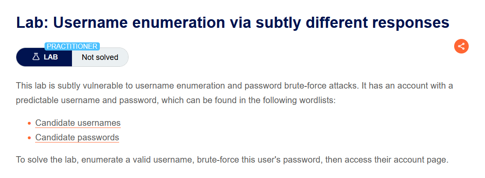
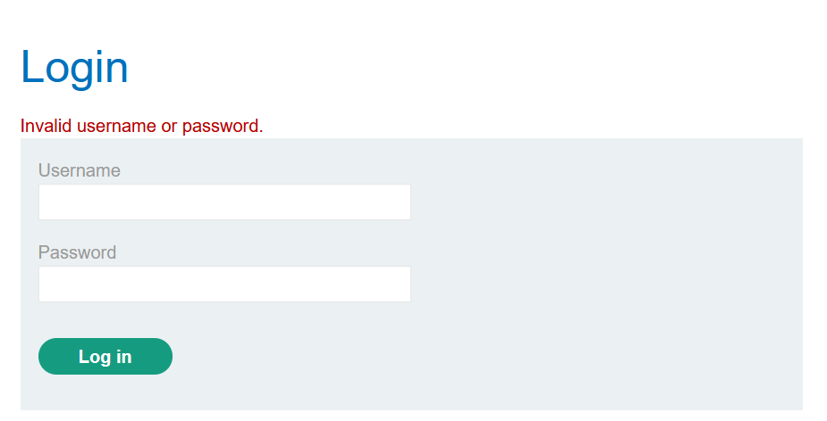
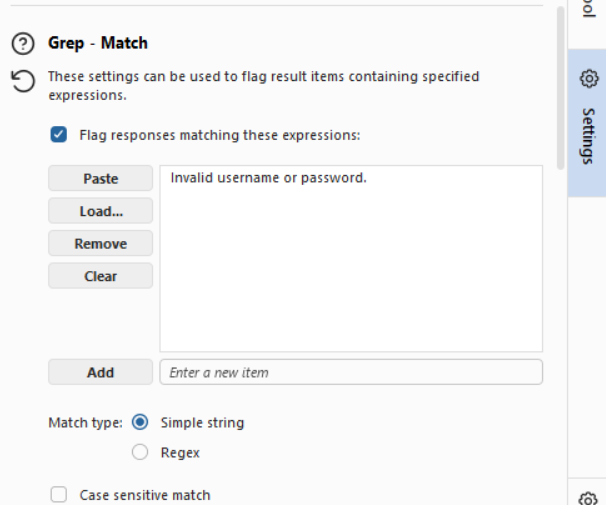
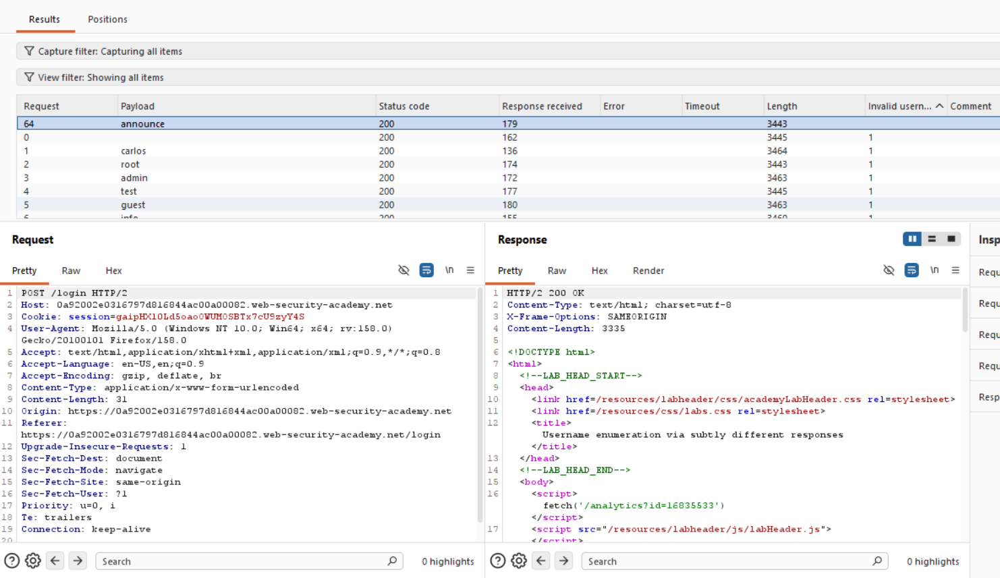
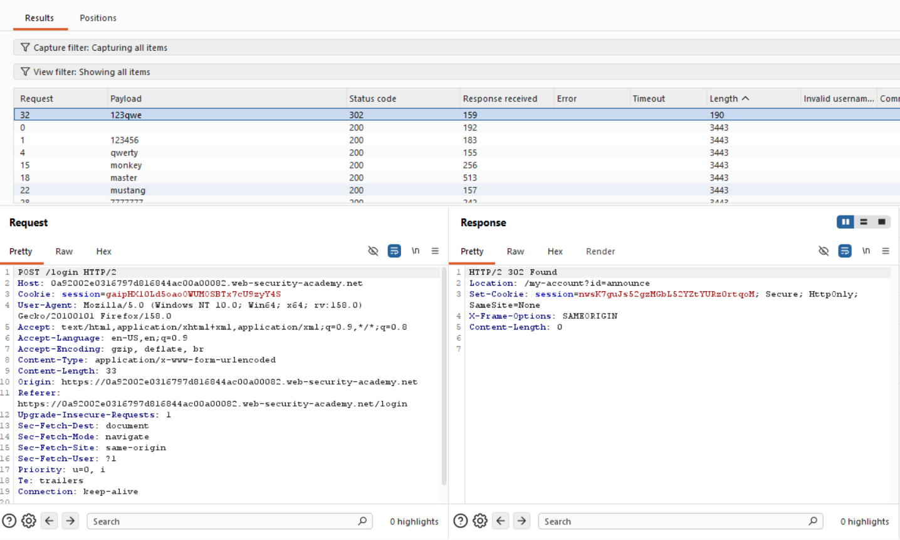
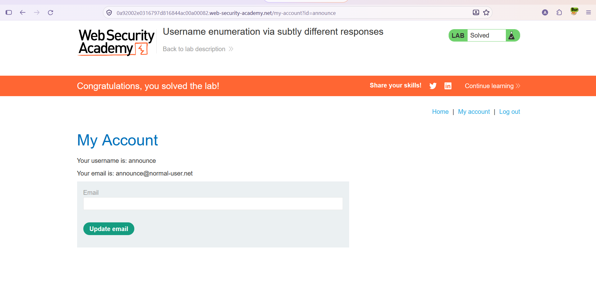

# Authentication — İnce Farklarla Kullanıcı Adı Keşfi (Subtly Different Responses)

**Lab:** Username enumeration via subtly different responses
**Seviye:** Practitioner
**Kategori:** Authentication (Kimlik Doğrulama)
**Araçlar:** Burp Suite (Proxy / Intruder — Grep Match)
**Lab linki:** https://portswigger.net/web-security/authentication/password-based/lab-username-enumeration-via-subtly-different-responses

---

## Zafiyetin Özeti

Bu lab, bir önceki "farklı yanıtlar" lab'inin daha sinsi (subtle) bir versiyonudur. Yine kullanıcı adı keşfi ve parola brute-force'una açık; ama bu kez fark **gözle kolayca görülmüyor.** Uygulama, geçersiz girişlerde her seferinde neredeyse aynı hata mesajını döndürüyor:

```
Invalid username or password.
```

Ancak geçerli bir kullanıcı adı girildiğinde bu mesaj **çok küçük bir ayrıntıda** farklılaşıyor — örneğin sondaki nokta (`.`) olmaması gibi. Yanıt uzunlukları da birbirine çok yakın olduğundan, bu farkı yakalamak için uzunluğa bakmak yerine mesaj metnini **tam eşleştirme (Grep Match)** ile kontrol etmek gerekir.

Amaç: geçerli kullanıcı adını keşfetmek, parolasını brute-force ile bulmak ve hesaba erişmek.

## Lab Açıklaması



## Çözüm Adımları

### 1. Hata mesajını tespit etmek

Önce normal bir başarısız giriş yapıp dönen hata mesajını not ediyoruz:

```
Invalid username or password.
```



### Aşama 1 — Grep Match ile geçerli kullanıcı adını keşfetmek

Login isteğini Intruder'a gönderiyoruz, Sniper tipi ve payload pozisyonu `username` alanında. Bu lab'de uzunluk farkı güvenilir değil (yanıtlar çok yakın), bu yüzden **Grep - Match** özelliğini kullanıyoruz: Intruder ayarlarında hata mesajının tam metnini ekliyoruz (noktası dahil):

```
Invalid username or password.
```

Match tipi: **Simple string**.



Böylece Intruder, her yanıtın bu metni **içerip içermediğini** ayrı bir sütunda işaretler (1 = içeriyor, boş = içermiyor).

Saldırıyı başlatıp bu sütuna göre sıralıyoruz. Geçersiz kullanıcı adlarının tamamında metin bulunuyor (sütunda `1`), ama bir payload'da **bulunmuyor**: `announce`. Bu kullanıcının yanıtında hata mesajı ince bir farkla değiştiği (ör. sondaki nokta eksik olduğu) için tam metin eşleşmiyor.



Bu, `announce` kullanıcı adının **geçerli** olduğunu gösterir.

### Aşama 2 — Parolayı brute-force ile bulmak

Kullanıcı adını `announce` olarak sabitliyor, payload pozisyonunu `password` alanına taşıyoruz ve "Candidate passwords" listesini yüklüyoruz.

Saldırıyı başlatıyoruz. Ayırt edici işaret yine **durum kodu**: doğru parola `302 Found` dönüyor. `123qwe` payload'ı `302` ile öne çıkıyor (`Location: /my-account?id=announce`).



### Aşama 3 — Hesaba erişmek

`announce` / `123qwe` ile giriş yapıp hesaba erişiyoruz. Lab çözüldü.



## Neden Çalışıyor? (İşin Mantığı)

Bir önceki lab'de fark büyük ve gözle görülür bir metin değişikliğiydi (farklı hata mesajları, dolayısıyla belirgin uzunluk farkı). Bu lab'de geliştirici bunu "düzeltmeye" çalışmış ama eksik yapmış: hata mesajını her durumda aynı tutmak yerine, geçerli ve geçersiz kullanıcı adında **neredeyse aynı** ama tıpatıp aynı olmayan bir mesaj bırakmış. Tek bir karakterlik fark (ör. sondaki nokta) bile bir **yan kanal (side channel)** oluşturmaya yeter.

Bu fark o kadar küçük ki yanıt uzunluğuna bakmak yanıltıcı olabilir (içerik uzunlukları rastgele dolgularla da oynayabilir). Doğru teknik, aranan hata metnini **tam olarak** tanımlayıp her yanıtta var/yok diye işaretlemektir (Grep Match). Metin geçersiz kullanıcılarda tıpatıp eşleşir, geçerli kullanıcıda eşleşmez — ve böylece tek bir karakterlik sızıntı, geçerli kullanıcı adını ele verir.

Kök sebep aynıdır: **uygulama, geçerli ve geçersiz kullanıcı adını davranışında ayırt edilebilir kılıyor.** Farkın büyük ya da küçük olması sonucu değiştirmez; ölçülebilir herhangi bir fark enumeration için yeterlidir.

## Önlem

- **Gerçekten tek tip yanıtlar:** Tüm başarısız giriş durumlarında yanıt **birebir aynı** olmalı — aynı metin (noktası, boşluğu, büyük/küçük harfi dahil), aynı uzunluk, aynı durum kodu ve aynı yanıt süresi. "Neredeyse aynı" yeterli değildir.
- **Oran sınırlama ve hesap kilitleme:** Brute-force'u pratikte imkânsız kılar.
- **Çok faktörlü kimlik doğrulama (MFA).**
- **Güçlü parola politikası ve CAPTCHA.**
