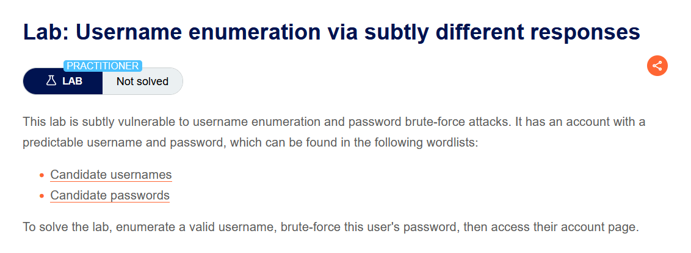
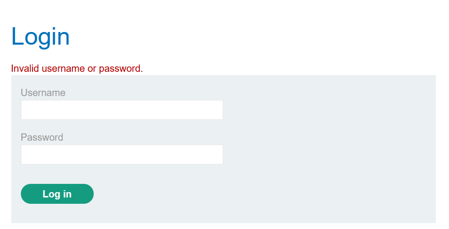
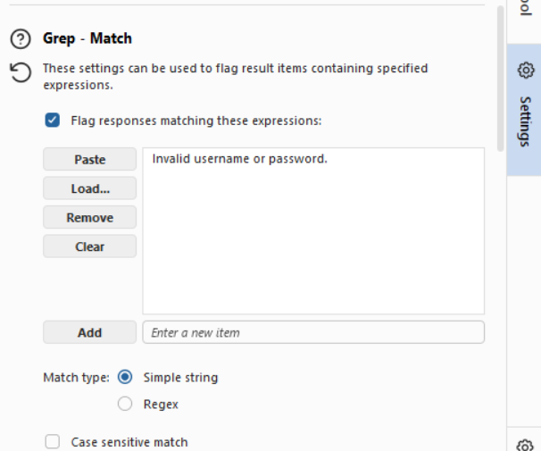
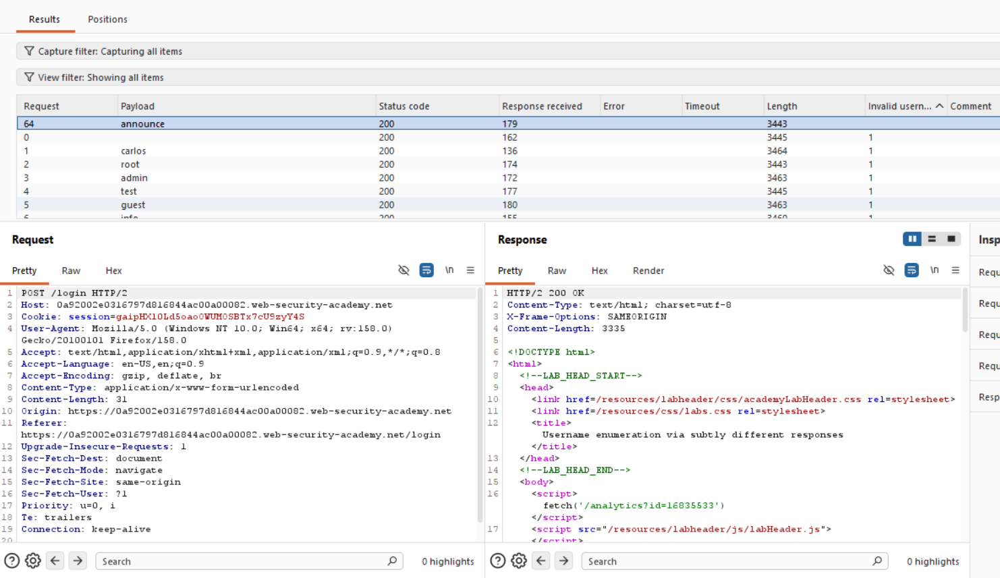
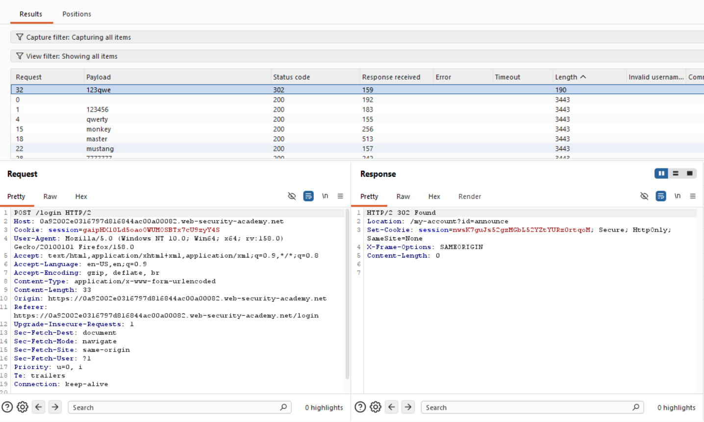
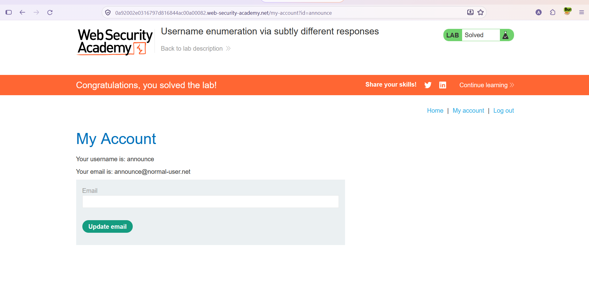

# Authentication — Username Enumeration via Subtly Different Responses

**Lab:** Username enumeration via subtly different responses
**Level:** Practitioner
**Category:** Authentication
**Tools:** Burp Suite (Proxy / Intruder — Grep Match)
**Lab link:** https://portswigger.net/web-security/authentication/password-based/lab-username-enumeration-via-subtly-different-responses

---

## Vulnerability Summary

This lab is a subtler version of the previous "different responses" lab. It is again vulnerable to username enumeration and password brute-force, but this time the difference is **not easily visible by eye.** On invalid logins the application returns almost the same error message every time:

```
Invalid username or password.
```

However, when a valid username is entered, this message differs in **one tiny detail** — for example, the trailing period (`.`) being absent. Response lengths are also very close, so instead of relying on length, we check the message text with an **exact match (Grep Match)** to catch the difference.

Goal: enumerate the valid username, brute-force its password, and access the account.

## Lab Description



## Solution Steps

### 1. Identify the error message

First we make a normal failed login and note the returned error message:

```
Invalid username or password.
```



### Stage 1 — Enumerate the valid username with Grep Match

We send the login request to Intruder, Sniper type, payload position on the `username` field. Length difference is not reliable here (responses are too close), so we use the **Grep - Match** feature: in Intruder settings we add the exact error message text (including its period):

```
Invalid username or password.
```

Match type: **Simple string**.



Intruder then flags, in a separate column, whether each response **contains** this text (1 = contains, empty = does not).

We start the attack and sort by that column. All invalid usernames contain the text (`1` in the column), but one payload **does not**: `announce`. Because the error message changes by a tiny difference (e.g. the trailing period missing) in this user's response, the exact text does not match.



This shows the username `announce` is **valid**.

### Stage 2 — Brute-force the password

We fix the username to `announce`, move the payload position to the `password` field, and load the "Candidate passwords" list.

We start the attack. The distinguishing signal is again the **status code**: the correct password returns `302 Found`. The `123qwe` payload stands out with `302` (`Location: /my-account?id=announce`).



### Stage 3 — Access the account

We log in with `announce` / `123qwe` and access the account. The lab is solved.



## Why It Works (The Logic)

In the previous lab the difference was a large, visible text change (different error messages, hence an obvious length difference). Here the developer tried to "fix" this but did it incompletely: instead of keeping the error message identical in every case, they left an **almost identical** but not exactly identical message for valid vs invalid usernames. Even a single-character difference (e.g. the trailing period) is enough to form a **side channel**.

The difference is so small that looking at response length can be misleading (content length may also shift due to random padding). The correct technique is to define the exact error text and flag its presence/absence in each response (Grep Match). The text matches exactly for invalid users and does not match for the valid user — so a single-character leak gives away the valid username.

The root cause is the same: **the application makes valid and invalid usernames distinguishable in its behavior.** Whether the difference is large or small does not change the outcome; any measurable difference is enough for enumeration.

## Remediation

- **Truly identical responses:** For all failed login cases the response must be **byte-for-byte identical** — same text (including period, spacing, casing), same length, same status code, and same response time. "Almost identical" is not enough.
- **Rate limiting and account lockout:** Makes brute-force practically impossible.
- **Multi-factor authentication (MFA).**
- **Strong password policy and CAPTCHA.**
